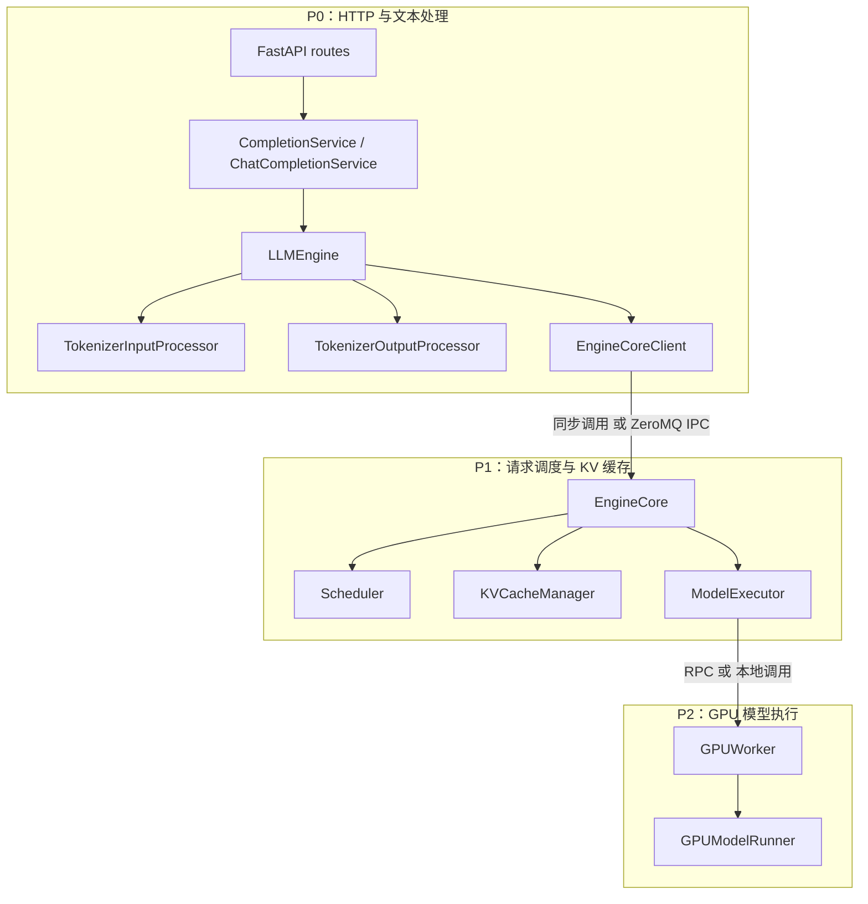
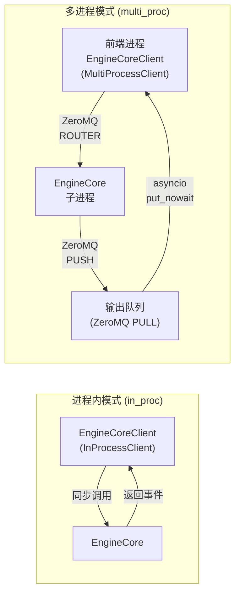

# 设计文档：xTokens 推理系统架构

## TLDR

xTokens 将推理分为三层：P0 HTTP 与文本处理、P1 请求调度与 KV 缓存管理、P2 GPU 模型执行。
`LLMEngine`（P0）通过 `EngineCoreClient` 与 `EngineCore`（P1）通信，共享调度器和 KV 缓存管理。
EngineCore 控制 `ModelExecutor`（P1/P2 边界），后者直接管理 GPU worker 和模型执行。
Core 可在进程内按需执行，也可在独立进程独立推进；两种模式共享同一调度接口。

## 背景

HTTP 请求的到达速率、生成结果的消费速率和 GPU 计算的吞吐速率不同步。将协议处理、
请求生命周期和 GPU 执行分层，既能支持直接调用验证推理链路，也能让独立 Core 进程
持续调度，不必阻塞等待 HTTP 客户端消费。KV 缓存的准入、分配、复用和释放由调度层统一管理。

设计原则是：P0 只处理文本和生成事件，P1 管理所有请求队列和块分配，P2 专注 GPU 执行。
Core 通信限于进程内调用或本机 IPC（ZeroMQ），不支持跨节点 RPC、多前端共享 Core 或
分布式数据并行。

## 架构概览



| 层级 | 组件 | 职责 | 设计文档 |
| --- | --- | --- | --- |
| P0 | FastAPI、Service、`LLMEngine` | HTTP 协议适配、文本分词反分词、请求生命周期管理 | [[S1-serve_api.md]] |
| P1 | `EngineCore` | 单线程事件循环、请求提交、调度循环、执行管理 | [[S2-engine_core.md]] |
| P1 | `Scheduler` | 请求队列、准入控制、prefill/decode 阶段调度、EOS/超长处理 | [[S4-scheduler.md]] |
| P1 | `KVCacheManager` | 块分配、前缀复用、容量驱动逐出、块生命周期 | [[S3-kv_cache_manager.md]] |
| P1/P2 | `ModelExecutor` | 执行控制平面、参数收集、batch 分发、采样集成 | [[S5-model_executor.md]] |
| P2 | `GPUWorker`、`GPUModelRunner` | 设备管理、模型权重、前向执行、采样生成 | [[S5-model_executor.md]] |

## 详细设计

### 请求处理流程

1. **HTTP 入口**（P0）：FastAPI 路由收到 `/v1/completions` 或 `/v1/chat/completions` 请求。
   Service 验证请求、生成请求 ID、转换为 `GenerateRequest`。

2. **文本到 Token**（P0）：`LLMEngine.generate()` 通过 `InputProcessor` 对 prompt 进行分词，
   得到 `ProcessedRequest`（token ID + sampling params）。

3. **请求提交**（P0 → P1）：`EngineCoreClient.add_request()` 将 token ID 请求提交给 EngineCore。
   进程内模式直接调用，多进程模式通过 ZeroMQ 发送。

4. **调度与执行**（P1）：`EngineCore.step_fn()` 执行一个调度步：
   - 调用 `Scheduler.schedule()` 准入新请求、选择 prefill/decode 阶段、获取 KV 缓存元数据。
   - 调用 `ModelExecutor.execute_model()` 执行前向推理。
   - 调用 `ModelExecutor.sample_tokens()` 采样生成 token。
   - 调用 `Scheduler.update_from_output()` 更新请求状态、管理 KV 缓存。
   - 生成 `CoreTokenEvent`、`CoreFinishedEvent` 或 `CoreErrorEvent`。

5. **结果分发**（P1 → P0）：`EngineCoreClient.get_output()` 返回事件批次。
   `LLMEngine._read_core_outputs()` 按 request_id 路由到对应请求的输出队列。

6. **Token 到文本**（P0）：`OutputProcessor` 对每个生成的 token 进行反分词，累积文本。

7. **HTTP 响应**（P0）：
   - 非流式（`stream=false`）：收集至 `CoreFinishedEvent` 或 `CoreErrorEvent`，
     返回完整 JSON `Completion` 或 `ChatCompletion`。
   - 流式（`stream=true`）：逐事件编码为 SSE 并返回，消费者可实时接收。

### Core 运行模式



| 模式 | Client 实现 | 执行方式 | 特点 |
| --- | --- | --- | --- |
| `in_proc` | `InProcessClient` | 调用方线程直接执行 `step_fn()` | 无序列化开销，同步阻塞 |
| `multi_proc` | `MultiProcessClient` | Core 子进程独立主循环 | 异步推进，IPC 开销 |

**进程内模式**：
- `EngineCoreClient.get_output()` 直接调用 `step_fn()` 和 `post_step()`。
- 所有调度、执行发生在调用方线程内；block 住 HTTP 请求处理。

**多进程模式**：
- `MultiProcessClient` 通过 `multiprocessing.spawn` 启动 `EngineCore.run_process()`。
- Core 子进程启动输入、输出 I/O 线程，独立主循环推进调度。
- 前端通过 ZeroMQ ROUTER/PULL 通道收发请求和事件。
- `get_output()` 只从共享输出队列消费，不 block 计算。

### 层级职责边界

```
┌─────────────────────────────────────────────────────┐
│ P0：HTTP 与文本处理                                  │
├─────────────────────────────────────────────────────┤
│ • HTTP 请求验证与响应格式化                         │
│ • 文本 ←→ Token ID 转换                            │
│ • 请求生命周期（创建、中止、清理）                 │
│ • 请求输出队列（无容量限制）                       │
└────────────────┬────────────────────────────────────┘
                 │ EngineCoreClient
                 │ (add_request, get_output, abort_requests)
                 ↓
┌─────────────────────────────────────────────────────┐
│ P1：请求调度与 KV 缓存管理                         │
├─────────────────────────────────────────────────────┤
│ • 请求队列（waiting, running）                     │
│ • 准入控制（max_num_seqs, KV 容量）               │
│ • 阶段选择（prefill vs decode）                   │
│ • KV 块分配、前缀复用、逐出                       │
│ • 请求生命周期（WAITING → RUNNING → FINISHED）   │
└────────────────┬────────────────────────────────────┘
                 │ ModelExecutor
                 │ (execute_model, sample_tokens)
                 ↓
┌─────────────────────────────────────────────────────┐
│ P2：GPU 模型执行                                    │
├─────────────────────────────────────────────────────┤
│ • GPU 设备管理                                      │
│ • 模型权重加载与管理                               │
│ • CUDA kernel 调用（前向、采样）                   │
│ • 张量并行协调（NCCL）                            │
│ • 设备侧 KV 缓存                                   │
└─────────────────────────────────────────────────────┘
```

## 测试与评估

- `tests/engine/test_engine_core.py`：单步调度、KV 块逐出、关闭清理。
- `tests/engine/test_inproc_client.py`：进程内和多进程模式、并发分发、启动和关闭。
- `tests/entrypoints/serve/test_app.py`：HTTP 路由、鉴权、错误处理。
- `tests/entrypoints/serve/test_p0_e2e.py`：从 HTTP 到文本输出的端到端验证。
- 验证状态：`pytest -q tests/engine tests/entrypoints/serve` 共 80+ 项通过；
  不包括真实模型 GPU 性能测试。

## 总结

三层分离将关注点清晰划分：P0 只处理协议和文本，P1 负责所有调度和块管理，
P2 专注 GPU 执行。两种 Core 运行模式共享相同的调度算法和请求接口，支持灵活的
进程布局选择。设计允许未来扩展分布式 Core、多卡张量并行和块预填充等功能，
同时保持核心调度逻辑不变。
