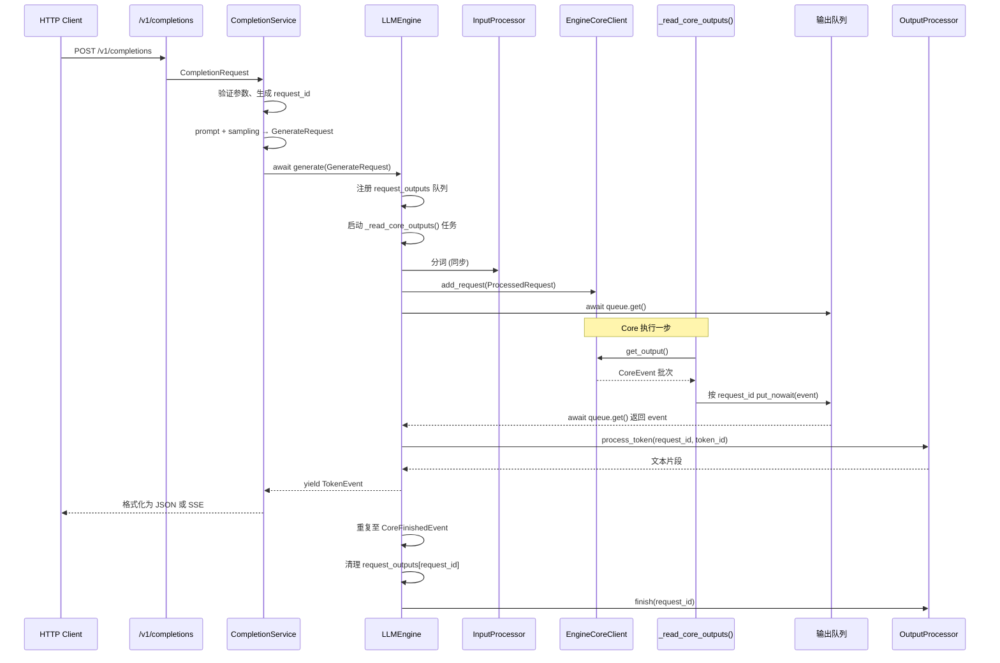
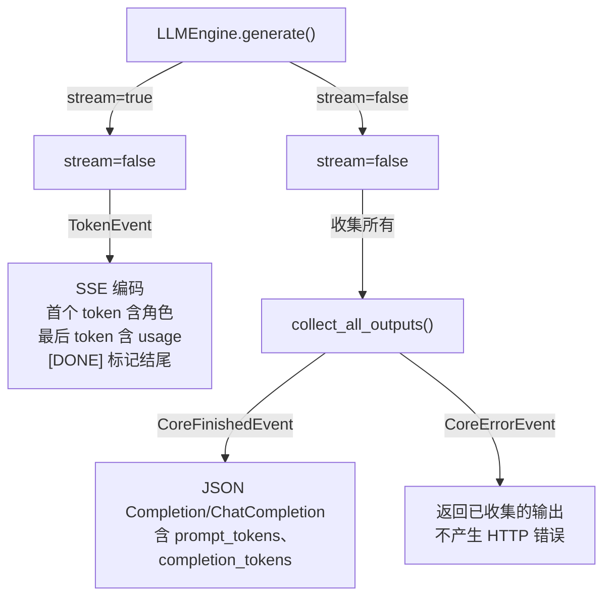

# 设计文档：API Server（P0）

## TLDR

API Server 是 xTokens 的 HTTP 入口，提供 OpenAI 兼容的 Completion 和 Chat Completion 接口。
一个共享的 `LLMEngine` 负责分词、反分词和请求生命周期管理；FastAPI 应用在 lifespan 中创建和销毁它。
请求流程为：HTTP → Service → InputProcessor（分词）→ EngineCoreClient → 输出队列 → OutputProcessor（反分词）→ JSON/SSE。
非流式和流式共用 `LLMEngine.generate()`，只在序列化时分支。

## 背景

Completion 和 Chat Completion 是两种不同的 HTTP 协议，但生成任务本质相同（文本 → token ID → 文本）。
为避免重复实现分词反分词和请求管理，应该在 HTTP 层上方建立统一的文本生成接口，让两个端点只负责协议转换。
分词发生在提交前，反分词发生在消费结果时，两者都由 P0 负责；Core 只处理 token ID 生成。

API Server 范围限于单模型文本生成，不支持 token ID 形式的输入、chat template 或工具调用。
系统边界见 [[S0-arch.md]]。

## 目标

1. 提供 OpenAI 兼容的 HTTP API，支持 JSON 和 SSE 两种响应格式。
2. 在 P0 完成文本↔Token 转换，P1 只处理 token ID。
3. 两个生成端点共享一个 Engine 实例和调度器，避免资源重复。
4. 支持请求中止、超时和错误处理。
5. 验证鉴权、请求 ID 隔离和并发生成。

## 非目标

- 支持多模型路由或动态加载。
- 实现 chat template 或模型特定的指令格式。
- 提供 token 级细粒度背压或流量控制。
- 支持流式请求体或分块 prompt 上传。

## 设计概述

### 架构与目录

```
entrypoints/serve/
├── app.py                      # 创建 FastAPI 应用，lifespan 管理 LLMEngine
├── routes/
│   ├── completion.py           # POST /v1/completions
│   └── chat_completion.py      # POST /v1/chat/completions
├── services/
│   ├── completion_service.py   # CompletionService：request → response
│   ├── chat_completion_service.py
│   ├── request_processor.py    # 转换 HTTP 请求为 GenerateRequest
│   └── response_processor.py   # 聚合 EngineEvent 为 JSON 响应
├── openai/
│   └── protocol.py             # Pydantic DTO：CompletionRequest 等
└── sse_serializer.py           # 生成 SSE 格式的事件流

engine/
├── llm_engine.py               # LLMEngine：统一的文本生成接口
├── protocol.py                 # GenerateRequest, EngineEvent 等类型定义
├── input_processor.py          # InputProcessor 协议和 TokenizerInputProcessor 实现
├── output_processor.py         # OutputProcessor 协议和 TokenizerOutputProcessor 实现
└── core_client.py              # EngineCoreClient：与 EngineCore 通信
```

| 模块 | 职责 |
| --- | --- |
| `create_app()` | 在 FastAPI lifespan 中创建 `LLMEngine`、注册路由、设置鉴权和 CORS |
| `/ready`、`/v1/models` | 健康检查和模型列表 |
| `/v1/completions` route | 参数验证、请求 ID 分配、调用 `CompletionService` |
| `/v1/chat/completions` route | 参数验证、请求 ID 分配、调用 `ChatCompletionService` |
| `CompletionService`、`ChatCompletionService` | 转换 HTTP 请求为 `GenerateRequest`，调用 `LLMEngine.generate()`，逐事件处理 |
| `LLMEngine` | 管理请求输出队列、分词反分词、请求生命周期、与 EngineCore 通信 |
| `InputProcessor` | 文本 → token ID 转换 |
| `OutputProcessor` | token ID → 文本转换 |

### 请求生命周期



### LLMEngine 核心接口

```python
class LLMEngine:
    async def generate(request: GenerateRequest) -> AsyncIterator[EngineEvent]:
        """
        文本生成的稳定接口。
        流程：
        1. 创建 request_outputs 队列，启动 _read_core_outputs() 任务
        2. 对 prompt 分词得到 ProcessedRequest
        3. 通过 EngineCoreClient 提交
        4. 等待队列中的 CoreEvent，转换为 EngineEvent
        5. 收到 CoreFinishedEvent 或 CoreErrorEvent 后结束
        6. 异常时尝试 abort_requests()
        7. 清理队列和 OutputProcessor 状态
        """
        
    async def _read_core_outputs() -> None:
        """
        共享 task，定期轮询 get_output()，按 request_id 路由事件到各队列。
        空闲时 sleep(0.001)，有事件时 sleep(0)。
        异常时唤醒所有活跃请求的队列。
        """
        
    def parse_output(event: CoreEvent) -> EngineEvent:
        """
        将 Core 的 CoreTokenEvent / CoreFinishedEvent / CoreErrorEvent
        转换为 API 层的 TokenEvent / FinishedEvent / ErrorEvent。
        """
        
    async def close() -> None:
        """
        应用关闭时调用，尝试中止活跃请求、停止输出任务、关闭 Core Client。
        """
```

### CompletionService 与 ChatCompletionService

```python
async def handle_completion(request: CompletionRequest, request_id: str):
    """
    转换 HTTP 请求为 GenerateRequest：
    - prompt: 字符串
    - sampling: CompletionRequest 的采样参数
    返回一个 AsyncIterator[EngineEvent]。
    """
    
async def handle_chat_completion(request: ChatCompletionRequest, request_id: str):
    """
    转换 HTTP 请求为 GenerateRequest：
    - prompt: messages 拼接为 "role: content\nrole: content\n..."
    - sampling: ChatCompletionRequest 的采样参数
    返回一个 AsyncIterator[EngineEvent]。
    """
```

### 响应格式



非流式流程：
- `collect_all_outputs()` 循环调用 `generate()`，收集至 `CoreFinishedEvent` 或 `CoreErrorEvent`。
- 拼接文本、计算 tokens，返回 `Completion` 或 `ChatCompletion` JSON。
- 当前 `CoreErrorEvent` 不会转成 HTTP 500，而是作为正常响应体返回。

流式流程：
- `serialize_completion()` 或 `serialize_chat()` 逐事件生成 SSE。
- 对于 Chat，首个 `TokenEvent` 包含 `role: "assistant"`。
- 最后的 `TokenEvent` 或 `FinishedEvent` 包含 usage。
- 事件流以 `data: [DONE]` 结尾。
- 当前 `stream_options.include_usage` 未实现。

### HTTP 路由

| 方法 | 路径 | 参数 | 响应 |
| --- | --- | --- | --- |
| `GET` | `/ready` | — | `200 {"ready": true}` 或 `503 {"ready": false}`；免鉴权 |
| `GET` | `/v1/models` | — | `200 {"data": [{"id": served_model_name}]}` |
| `POST` | `/v1/completions` | `CompletionRequest` (prompt, model, temperature, top_p, max_tokens, stream, ...) | `200` + JSON `Completion` 或 SSE |
| `POST` | `/v1/chat/completions` | `ChatCompletionRequest` (messages, model, temperature, top_p, max_tokens, stream, ...) | `200` + JSON `ChatCompletion` 或 SSE |

**错误处理：**
- 配置了 `api_key` 时，所有端点（除 `/ready`）要求 `Authorization: Bearer <key>`；缺失或不匹配返回 `401`。
- 生成路由模型不匹配返回 `404`。
- 引擎未就绪返回 `503`。
- 请求校验失败返回 `422` + OpenAI 风格 error 对象。
- 重复 request_id 返回 `409`（当前未实现）。

**请求 ID 管理：**
- 若传入 `X-Request-ID` header，使用该值；否则生成 `cmpl-` 或 `chatcmpl-` 开头的 ID。
- `LLMEngine` 检测重复 ID，拒绝已在运行的请求。
- 响应体和响应头均包含 request_id。

### 配置与启动

`create_app(config: XTokensConfig)` 在 FastAPI lifespan 中：
1. 读取 `config.server_config` 和 `config.model_config`。
2. 构造 `InputProcessor`（从 HuggingFace 加载 tokenizer）。
3. 通过 `EngineCoreClient.make_client()` 读取 `core_client_mode`。
4. 构造 `LLMEngine`，设置 `core_client`。
5. 注册路由、鉴权 middleware、CORS、错误处理。

`ServerConfig` 参数：
- `host`、`port`：监听地址。
- `api_key`：可选，若设置则需要 Bearer token。
- `served_model_name`：模型别名，用于 `/v1/models` 和请求验证。
- `core_client_mode`：`"in_proc"`（默认）或 `"multi_proc"`。

### 错误与清理

**正常结束：**
- 收到 `CoreFinishedEvent` → `FinishedEvent` → HTTP 200。

**生成器中止：**
- 若调用方取消生成器（如 HTTP 客户端断连），`finally` 块调用 `abort_requests()`。

**Core 异常：**
- 若 `_read_core_outputs()` 捕获异常，向所有活跃请求队列放入该异常。
- 相应 `generate()` 再次抛出，cleanup 路径执行。

**应用关闭：**
- 若应用关闭时 `LLMEngine.close()` 被调用（FastAPI lifespan），
  尝试中止活跃请求、停止输出任务、清理 Core Client。

## 测试与评估

**单元与集成测试：**
- `tests/entrypoints/serve/test_app.py`：
  - 请求 ID 验证与重复检测。
  - 鉴权：API key 检验、缺失返回 401。
  - 错误处理：模型不匹配返回 404、引擎未就绪返回 503。
  - JSON 和 SSE 响应格式。
- `tests/entrypoints/serve/test_p0_e2e.py`：
  - 从 HTTP 请求到文本输出的端到端验证。
  - 使用本地 tokenizer 和测试用 Core。
  - 验证 SSE 错误处理。
- `tests/entrypoints/serve/test_cli.py`：
  - CLI 参数解析。
  - 配置构造（tokenizer 路径、模型名等）。
- `tests/engine/test_inproc_client.py`：
  - Core Client 两种模式的行为。
  - 并发结果分发、请求 ID 隔离。

**验证状态：**
- `pytest -q tests/entrypoints/serve/ tests/engine/test_inproc_client.py` 共 80+ 项通过。
- 不包括真实模型 GPU 端到端或性能基准。

## 总结

API Server 通过 `LLMEngine` 统一处理两个生成端点。路由和 Service 专注协议适配，
Engine 负责文本处理、请求隔离和生命周期。JSON 和 SSE 是同一事件流的两种输出方式。
两种 Core 运行模式（进程内和多进程）对 P0 透明，共享同一套接口。
