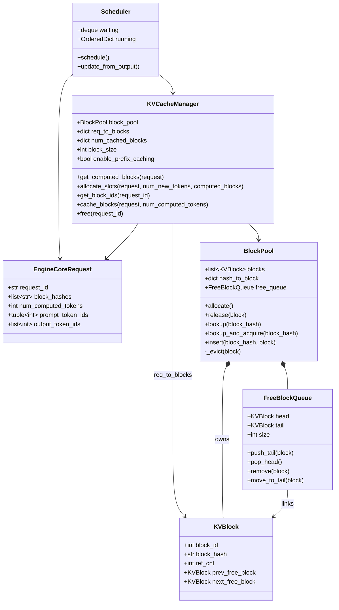
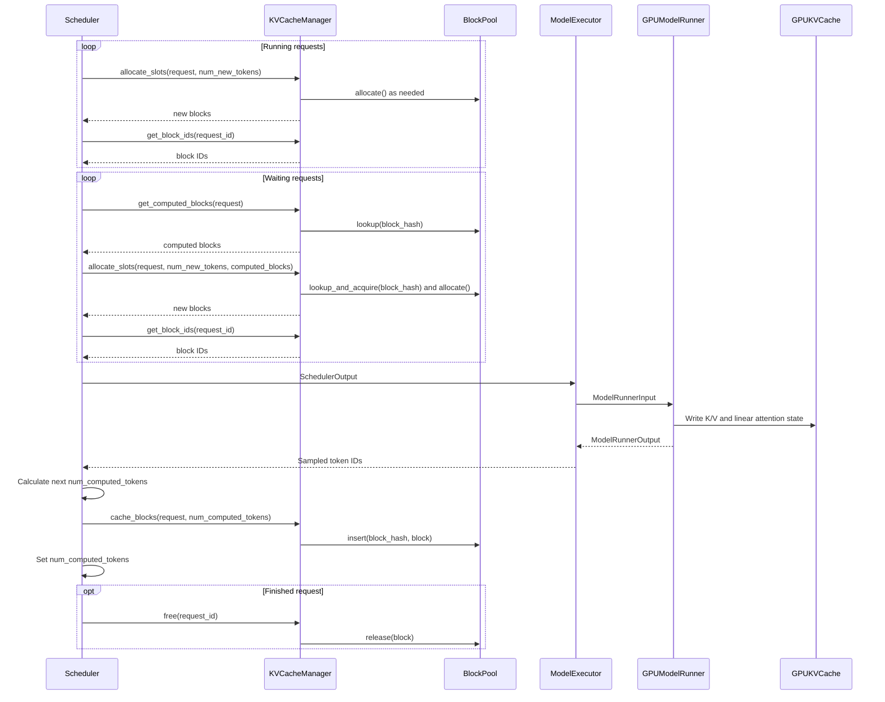

# 设计文档：KV Cache Manager

## 摘要

`KVCacheManager` 管理请求持有的有序 block 表。`BlockPool` 持有所有物理 block、前缀 hash 索引和空闲队列。Scheduler 为本步 token 分配 block，Runner 使用 block IDs 定位 GPU KV 写入位置。forward 成功后，完整 block 才进入 APC 索引。

## 背景

Qwen3.5 的全注意力和线性注意力使用同一套 block IDs。全注意力保存 block 内的逐 token K/V，线性注意力在 block 中保存卷积和递归状态。Scheduler 负责给请求安排 token chunk，物理块的引用计数和回收由块池集中管理。

## 目标

- 分离请求级 block 分配和物理块生命周期。
- 前缀查找、容量检查和引用获取按同一轮调度执行。容量不足时，请求和块池保留原有状态。
- 复用完整的连续前缀，按队列顺序回收引用计数为零的 block。
- 在 Runner 侧根据当前 token 位置和有序 block IDs 计算写入槽位。

## 非目标

本次重构的范围是单个 EngineCore 的逻辑 KV 管理。GPU 存储布局和模型的注意力计算由 `GPUKVCache` 与模型层管理。

## 设计概述

请求的计算进度和前缀 hash 保存在 `EngineCoreRequest`。Scheduler 将本步 token、计算起点和 block IDs 记录到 `SchedulerRequest`。ModelExecutor 把本步 token 区间和 block IDs 交给 GPUModelRunner。

## 详细设计

### 接口与数据结构

`req_to_blocks` 保存请求拥有的有序块，`num_cached_blocks` 记录已经登记的完整前缀块数。前缀 hash 由模型标识、上一个 block 的 hash 和当前 block 的 token IDs 组成，命中时再核对 token IDs。查找会保留最后至少一个 token 供 forward 产生 logits。

`FreeBlockQueue` 包含所有引用计数为零的 block。查到一个可复用的空闲块后，对应节点在获取引用时从队列移除。最后一个引用释放时，节点回到队尾。分配时从队首取 block，若该 block 有前缀索引则先逐出。请求释放多个 block 时按后缀到前缀的顺序入队，以便优先保留连续前缀。

### 核心流程

容量检查同时计入新块和即将被占用的空闲命中块。检查通过后，Manager 才获取引用和分配新块。Running 请求分配不足时，Scheduler 释放队尾请求并重试。等待请求分配不足时留在队列中。模型执行失败、取消和请求完成都通过 `free()` 释放引用。

### 兼容性与迁移

HTTP 接口、KV 配置和模型 checkpoint 沿用原格式。内部缓存接口以 `get_computed_blocks()`、`allocate_slots()`、`get_block_ids()`、`cache_blocks()` 和 `free()` 为准。

## 测试与评估

`test_block_pool.py` 覆盖链表更新、共享块引用和同 hash 的重复分配。`test_kv_cache_manager.py` 验证并发请求的分配、失败后的状态、前缀复用、抢占恢复和后缀优先逐出。`test_qwen3_5.py` 与 Transformers 对照全注意力和线性注意力的结果。

## 权衡与已知问题

单一空闲队列同时提供可分配容量和逐出顺序。任何未被持有的块都可以满足新分配。前缀命中只沿连续完整的 block 查找，部分块作为请求私有状态使用。

## 结论

Scheduler 以 token 数驱动调度。Manager 管理请求到 block 的映射，Pool 负责共享、释放和逐出，Runner 负责把 block IDs 映射到物理槽位。
