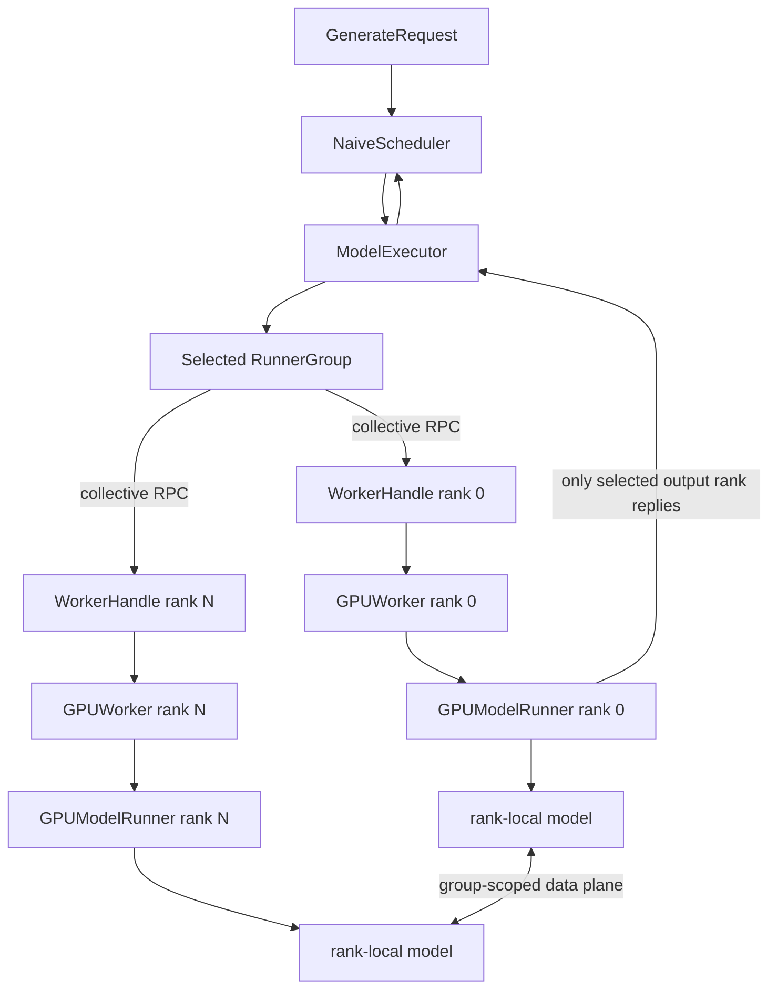
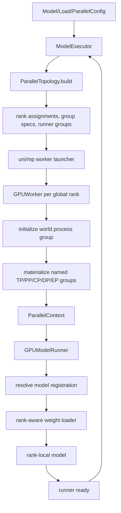
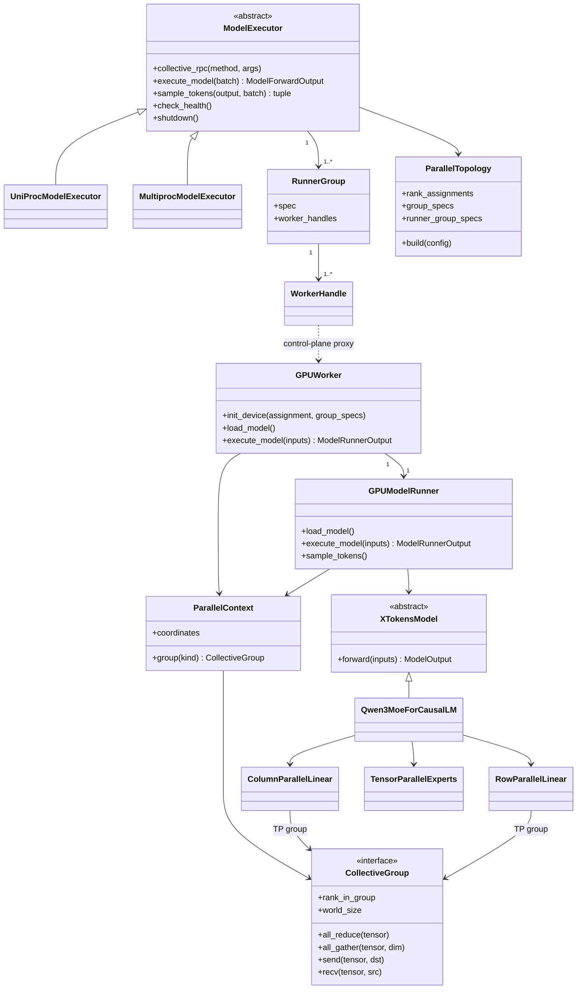
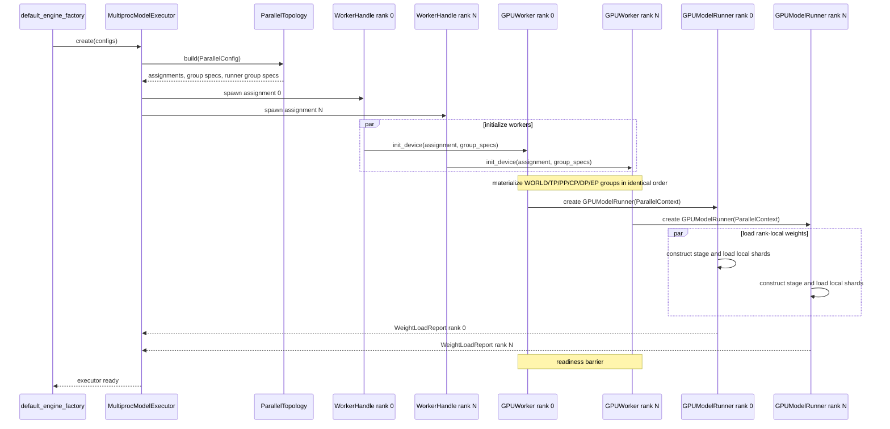
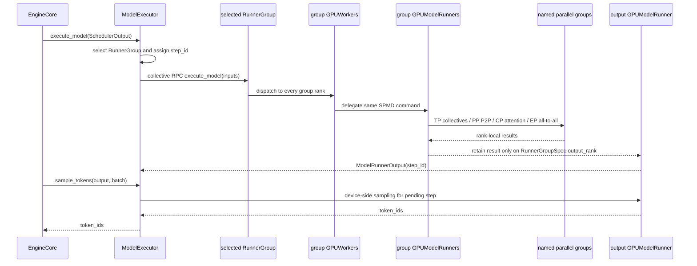
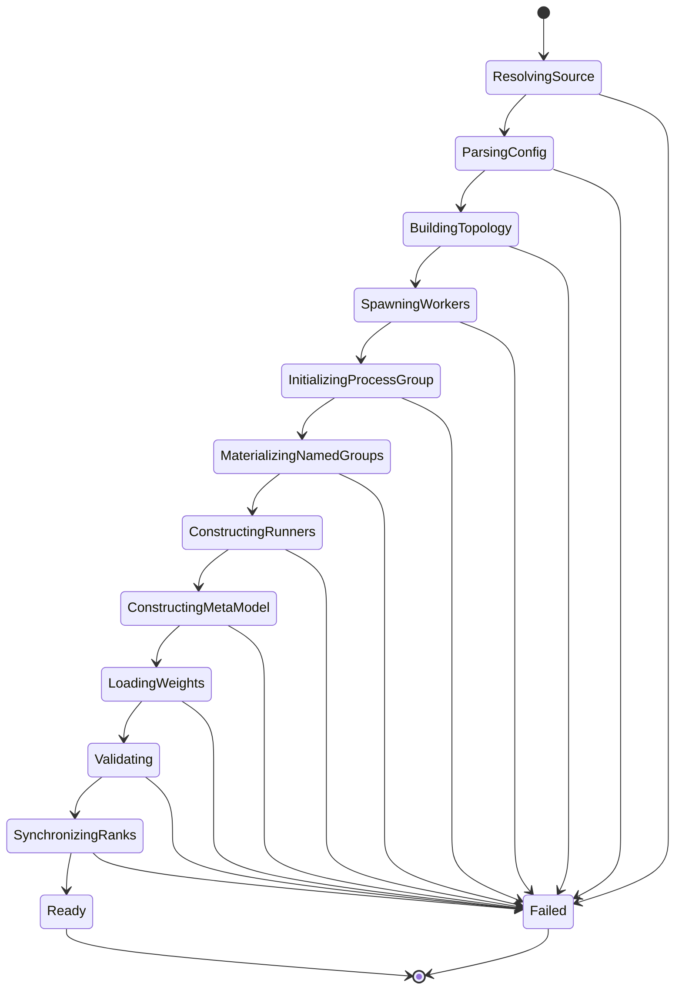

# 设计文档

## 摘要

xTokens 新增统一的 `ModelExecutor` 作为 Engine 面向模型执行的唯一入口。`ModelExecutor` 根据启动时读取的 `ParallelConfig` 生成 rank 拓扑和并行组规格，通过 uni/mp backend 管理多个 worker handle；每个 worker process 持有一个 `GPUWorker`，由 `GPUWorker` 初始化 device 和实际 process groups，并持有一个以 SPMD 方式运行的 `GPUModelRunner`。`GPUModelRunner` 负责 rank-local model、权重加载、输入准备、forward 和 device-side sampling，模型与 layer 只依赖通用 `ParallelContext` 中的 TP/PP/EP/CP group，不依赖 Executor 或 Scheduler。首个模型正确性基线只启用 TP=1/2，运行 Qwen3-30B-A3B；group registry、rank coordinates、runner contract 和 parameter shard metadata 从一开始覆盖 TP、PP、EP、CP 的扩展边界。系统继续兼容 HF config、tokenizer 和 SafeTensors，现有 `NaiveHFExecutor` 保持默认实现和正确性回退。本设计已核对本机 `/model`，并参考本地 vLLM 0.26.0 的 Executor、GPUWorker、GPUModelRunner、parallel state、parallel linear 与 Qwen3-MoE 分层。当前已经实现 topology、process-local group、uni/mp executor、GPUWorker/GPUModelRunner、device-side sampling、TP linear，以及从 model path/Hub ID 到 Qwen3-MoE architecture、runner 和 rank-local SafeTensors 权重的完整装配链路；tiny Qwen3-MoE 的 TP=1/2 CPU/Gloo 数值测试已经与 Transformers 对齐，真实 Qwen3-30B-A3B 也已完成两张 RTX A6000 上的 CUDA/NCCL strict load、单步 forward/generation 和正常 shutdown smoke test，完整数值与性能基线仍待补充。

## 背景

当前 xTokens 的模型执行完全由 `NaiveHFExecutor` 调用 Hugging Face：

```text
model path / Hub ID
    ↓
AutoModelForCausalLM.from_pretrained()
    ↓
Hugging Face model.forward()
    ↓
ModelForwardOutput.logits
```

该路径适合建立功能基线，但模型结构、attention backend、MoE token dispatch、权重布局和 forward 中间张量都由 Transformers 控制。xTokens 无法针对目标硬件替换单个 layer、融合 QKV/SwiGLU、控制 logits materialization、设计 KV cache 接口，或让多个 rank 以明确的 collective 语义共同执行一个 layer。

仓库当前主要目标模型是本地 `/model` 中的 Qwen3-30B-A3B：

- `config.json` 的 `model_type` 为 `qwen3_moe`，`architectures` 为 `Qwen3MoeForCausalLM`。
- 48 层、hidden size 2048、32 个 Q head、4 个 KV head、显式 `head_dim=128`。
- 每层 128 个专家，每 token 选择 8 个专家，MoE intermediate size 为 768。
- checkpoint 由 16 个 SafeTensors shard 组成，共 18,867 个 tensor key。
- HF checkpoint 为逐专家权重：`experts.<id>.gate_proj/up_proj/down_proj.weight`。
- bf16 权重约 61 GB，需要至少两张 48 GB GPU；当前 HF 路径使用 `device_map="auto"` 做 layer-wise model placement，而不是 Tensor Parallel。

因此，第一版 custom model 不能把“模型结构”“TP worker”和“多进程 executor”合并成一个类。Executor、Worker、ModelRunner、model/layer 和 distributed group 必须各自拥有单一职责；TP=2 只是第一种落地拓扑，而不是这些接口中写死的唯一并行方式。

四个概念需要严格区分：

| 名称 | 示例 | 职责 |
|---|---|---|
| `ModelConfig.model` | `/model` 或 `Qwen/Qwen3-30B-A3B` | checkpoint 来源 |
| `ModelConfig.served_model_name` | `qwen3-30b-a3b` | OpenAI API 展示和路由别名 |
| HF `config.architectures` | `Qwen3MoeForCausalLM` | 选择具体任务模型实现 |
| HF `config.model_type` | `qwen3_moe` | 选择 config adapter，并校验模型族 |

模型注册不得使用 `served_model_name`，也不能根据目录名猜测架构。

## 目标

- 建立统一 `ModelExecutor` 对外执行层，通过 runner group 支持单设备和分布式执行。
- 建立 `GPUWorker -> GPUModelRunner -> rank-local model` 的 SPMD 执行层次。
- 将 control plane（worker RPC/生命周期）与 data plane（NCCL collective/PP P2P/EP all-to-all）分离。
- 建立 xTokens 自有的 modeling 层，不依赖 HF model class 执行 forward。
- 同时支持本地 HF 模型目录和 Hugging Face Hub model ID。
- 读取标准 HF `config.json`，转换为经过严格校验的内部 model config。
- 通过显式 registry 将 `architectures` 和 `model_type` 映射到 model/config/weight mapper。
- 流式加载单文件或分片 SafeTensors，避免构造完整 CPU `state_dict`。
- 严格检查 missing、unexpected、expert schema 混用和 shape 错误；按目标参数 dtype 转换权重。
- 支持 HF checkpoint 名称到 xTokens 参数布局的一对一、切片和融合映射。
- 建立由 `ParallelConfig` 驱动的 `ParallelTopology`、`ParallelGroupSpec`、`RankCoordinates` 和 process-local `ParallelContext`。
- 同一 runner contract 能表达 TP、PP、EP、CP；第一阶段仅启用 TP=1/2，其余 group 以 singleton/disabled 语义存在。
- 提供 `ReplicatedLinear`、`ColumnParallelLinear`、`RowParallelLinear`、`MergedColumnParallelLinear` 和 `QKVParallelLinear`。
- 权重加载器直接加载当前 rank 所需的 shard，不在任一 GPU 上物化完整 30B 参数。
- 第一版实现 Qwen3-30B-A3B 的 embedding、RMSNorm、GQA、Q/K norm、RoPE、MoE 和 LM head。
- 第一版保持 no-KV-cache 语义，与 `NaiveHFExecutor` 进行 logits/token parity 验证。
- 第一版通过 `MultiprocModelExecutor` 管理两个 `GPUModelRunner` rank，使真实 61 GB bf16 checkpoint 可以按 TP=2 加载和执行。
- 保留现有 `Executor`、Scheduler、Engine 和 OpenAI API 边界。
- 为 attention、MoE、linear、quantization、KV cache 和 Expert Parallel 预留可替换实现点。

## 非目标

第一阶段不包含：

- KV cache、paged attention、prefix cache 或 chunked prefill。
- PP、EP、CP、DP 的实际模型执行、调度策略及其与 TP 的组合；第一阶段只完成通用拓扑和接口，不宣称这些模式可用。
- CUDA Graph、FlashAttention 自定义 kernel、fused MoE kernel 或量化。
- 训练、反向传播、router auxiliary loss 或 HF `GenerationMixin`。
- 任意 HF architecture 自动运行；未注册的 `model_type` 必须快速失败。
- `trust_remote_code=True` 或执行 checkpoint 仓库中的任意 Python 代码。
- GGUF、PyTorch pickle `.bin`、GPTQ、AWQ 或其他非 SafeTensors 格式。
- 替换 tokenizer/chat template；第一阶段继续使用 `AutoTokenizer`。
- 在模型层处理 sampling、请求状态、SchedulerOutput 或 HTTP 对象。

上述能力应在 correctness baseline 完成后分别设计，不能在第一版中通过不稳定的占位接口假装支持。

## 设计概述

### 目录结构

建议目录结构：

```text
x_tokens/
├── distributed/
│   ├── __init__.py
│   ├── topology.py               # RankCoordinates/ParallelGroupSpec
│   ├── parallel_context.py       # process-local named group registry
│   └── communication.py          # group-scoped collective/P2P
├── modeling/
│   ├── __init__.py
│   ├── config.py                 # ModelLoadConfig 和内部 architecture config
│   ├── interfaces.py             # ModelInput/ModelOutput/XTokensModel
│   ├── registry.py               # ModelRegistry/ModelRegistration
│   ├── loader/
│   │   ├── __init__.py
│   │   ├── source.py             # local/Hub source resolution
│   │   └── safetensors_loader.py # manifest、名称映射、rank-local load report
│   ├── layers/
│   │   ├── embedding.py          # VocabParallelEmbedding/ParallelLMHead
│   │   ├── linear.py             # replicated/column/row/QKV parallel linear
│   │   └── normalization.py      # RMSNorm
│   └── models/
│       ├── __init__.py           # 显式注册内置模型
│       └── qwen3_moe.py          # attention、RoPE、MoE、model 和 runner factory
├── worker/
│   ├── base.py                   # ModelWorker contract
│   ├── gpu_worker.py             # device/distributed 生命周期
│   └── model_runner/
│       ├── base.py               # ModelRunner contract
│       └── gpu_model_runner.py   # rank-local SPMD runner
└── executor/
    ├── base.py
    ├── naive_hf_executor.py
    ├── model_executor.py         # 统一外部接口与 collective RPC
    ├── uniproc_model_executor.py # 单 worker backend
    ├── multiproc_model_executor.py # 多 worker backend
    └── worker_handle.py          # process/RPC handle，不持有 CUDA model
```

`executor` 负责 worker 数量、rank assignment、RPC、健康检查和输出 rank 选择；它在多进程模式下持有的是
`WorkerHandle`，真正的 `GPUModelRunner` 位于 worker address space。`GPUWorker` 负责 device、process group、
memory snapshot 和 runner 生命周期；`GPUModelRunner` 负责模型相关执行。`modeling` 负责 config、module、
layer 和 checkpoint shard，不能 import Executor、Worker 或 Scheduler。`distributed` 不理解模型和请求。

`TransformerLayer` 不作为通用 building block。RMSNorm、RoPE、attention backend、linear 和 MoE
适合复用；residual 顺序、norm 位置、Q/K norm 和 dense/MoE 选择属于具体 architecture，应保留在
`models/qwen3_moe.py`。

### 运行时数据流



### 加载数据流



## 详细设计

### 核心流程

系统启动分为十三步：

1. 配置层一次性构造不可变的 `ModelConfig`、`ModelLoadConfig`、`ParallelConfig` 和 `ExecutorConfig`；运行中不得由某个 rank 单独修改并行尺寸。
2. `ModelExecutor.get_class()` 根据 `distributed_executor_backend` 选择 `UniProcModelExecutor` 或 `MultiprocModelExecutor`，该选择与具体 model architecture 无关。
3. `ModelSourceResolver` 接收 `ModelLoadConfig.model`。本地目录直接解析；Hub ID 使用
   `huggingface_hub.snapshot_download()` 获取 config、tokenizer、SafeTensors index 和 shards，并遵守
   `revision`、`cache_dir`、`local_files_only`。
4. `ConfigLoader` 和 `ModelRegistry` 在 driver 侧解析 HF config、选择 model registration，并读取 SafeTensors manifest。driver 只做无 CUDA 的静态验证，resolved source path、内部 model config 和 manifest 作为只读启动参数传给 workers。
5. `ParallelTopology.build()` 根据所有并行维度计算 `world_size`、每个 global rank 的 `RankCoordinates`、device assignment、named `ParallelGroupSpec`，并为每个 DP replica 生成一个 `RunnerGroupSpec` 和对应 output rank。EP 是覆盖在物理 rank mesh 上的逻辑 group，不默认乘入 world size。
6. `ModelExecutor` 创建 rendezvous 和 worker assignments。uni backend 创建一个本地 worker；mp backend 使用 `spawn` 创建每个 local rank 的 `WorkerHandle`，并负责监控、超时和统一回收。
7. 每个 `GPUWorker` 绑定自己的 device，初始化 world process group。所有 worker 按拓扑给出的全局确定顺序共同 materialize TP/PP/CP/DP/EP group；driver 生成 group spec，但不能跨进程创建或传递实际 `ProcessGroup` 对象。
8. `GPUWorker` 使用本 rank 的 `RankCoordinates` 和 group handles 构造 process-local `ParallelContext`，然后创建一个 `GPUModelRunner`。Runner 不启动进程、不创建拓扑，也不持有其他 runner。
9. `GPUModelRunner` 根据 registration 构造本 rank 应拥有的 model stage：PP 决定 layer range，TP 决定 tensor shard，EP 决定 local experts，CP 通常复制权重但切分 sequence/token work。
10. rank-aware loader 根据 parameter 的 `ParameterShardSpec` 从同一 HF checkpoint 加载本 rank 所需 slice。每个 runner 生成 local report，`ModelExecutor` 汇总全局覆盖和逐 rank bytes。
11. 所有 runners 完成 load validation 和 readiness barrier 后，`ModelExecutor` 才对 Engine 标记 ready。任一 worker 失败都会使其所在 runner group 进入 failed 状态；第一阶段 DP=1，因此等价于整个 executor 失败。
12. 每次 `execute_model()`，`ModelExecutor` 先选择一个 runner group，再将 `SchedulerOutput` 转换为不含请求对象的 `ModelRunnerInput`，通过 collective RPC 向该组所有 runners 发送相同 `step_id` 和控制命令。组内 runners 以 SPMD 执行，相同 named group 内必须以相同顺序进入 collective；PP stage 可以根据 coordinates 执行不同 layer range，但仍属于同一 SPMD 程序。不同 DP runner group 后续可以独立接收不同请求流。
13. 只有所选 `RunnerGroupSpec.output_rank` 返回 `ModelRunnerOutput`；组内其他 rank 只返回完成状态。`sample_tokens()` 在该 output runner 上执行，`ModelExecutor` 将 token IDs 返回 Engine。

第一阶段 forward 仍采用当前 no-KV-cache 基线：`ModelExecutor` 对每个请求读取完整
`prompt_token_ids + output_token_ids`，左 padding 后形成 `[batch, sequence]` 的 `input_ids`、
`attention_mask` 和 `position_ids`，并构造 `ModelRunnerInput`。TP=2、PP=CP=1 时两个 runner 执行完全
相同的 layer/collective 顺序；parallel LM head 只处理每个序列最后一个有效位置，随后在 TP group 内
all-gather vocab shards，得到 `[batch, vocab_size]` logits。第一版允许 TP group 所有 rank 得到完整 logits，
但只由 output runner 保存、采样和回复；任何阶段都不得物化
`[batch, sequence, vocab_size]` 的完整 logits。

### 接口与数据结构

#### 模型来源与加载配置

```python
@dataclass(frozen=True, slots=True)
class ModelLoadConfig:
    model: str
    revision: str | None = None
    cache_dir: str | None = None
    local_files_only: bool = False
    dtype: str = "auto"
    strict_weights: bool = True

@dataclass(frozen=True, slots=True)
class ParallelConfig:
    distributed_executor_backend: Literal["uni", "mp"] = "uni"
    devices: tuple[str, ...] = ("cuda:0",)
    tensor_parallel_size: int = 1
    pipeline_parallel_size: int = 1
    context_parallel_size: int = 1
    data_parallel_size: int = 1
    enable_expert_parallel: bool = False
    expert_parallel_size: int | None = None
    collective_backend: str = "nccl"
    timeout_s: float = 120.0
```

`model` 是本地目录或 Hub ID，不是 served model alias。`dtype="auto"` 使用 checkpoint/config dtype；
显式转换只允许受支持的 floating dtype，不能静默把量化或整数权重转换为浮点。第一版只允许
`pipeline/context/data_parallel_size=1` 和 `enable_expert_parallel=false`，但配置字段、拓扑校验和 singleton
groups 已定义。物理 `world_size = DP * PP * CP * TP`，`devices` 必须覆盖所有 local ranks 且不得重复；
EP group 复用物理 mesh 中的 ranks，不自动增加 world size。rendezvous address/port 由 executor backend
生成，不属于 model config。

#### Executor、Worker 与 ModelRunner

`ModelExecutor` 实现当前 Engine 使用的 `Executor` contract，并增加通用 worker 编排能力：

```python
@dataclass(frozen=True, slots=True)
class RankAssignment:
    coordinates: "RankCoordinates"
    device: str

@dataclass(frozen=True, slots=True)
class RunnerGroupSpec:
    replica_index: int
    ranks: tuple[int, ...]
    output_rank: int

@dataclass(slots=True)
class RunnerGroup:
    spec: RunnerGroupSpec
    worker_handles: tuple[WorkerHandle, ...]

class ModelExecutor(Executor, ABC):
    runner_groups: tuple[RunnerGroup, ...]

    @abstractmethod
    def collective_rpc(
        self,
        method: str,
        *args: object,
        runner_group: int = 0,
    ) -> tuple[object, ...]: ...

    def execute_model(self, batch: SchedulerOutput) -> ModelForwardOutput: ...
    def sample_tokens(
        self,
        output: ModelForwardOutput,
        batch: SchedulerOutput,
    ) -> tuple[int, ...]: ...
    def check_health(self) -> None: ...
    def shutdown(self) -> None: ...
```

`RunnerGroup` 是一个完整模型副本的执行单元：它包含 TP/PP/CP 以及启用 EP 时共同完成一次 forward 的所有
ranks；`data_parallel_size` 决定 runner group 数量。`UniProcModelExecutor` 的 `WorkerHandle` 是本地直接调用
代理；`MultiprocModelExecutor` 的 handle 是 RPC/process handle。两种 backend 必须提供相同语义，模型和
runner 不得判断 backend 类型。collective RPC 只
传递启动、加载、执行、健康检查和 shutdown 等 control-plane command；hidden states、partial output、
expert tokens 等 data-plane tensor 使用 `ParallelContext` 中的 group communication。

这里的“`ModelExecutor` 持有多个 model runner”是逻辑所有权：uni backend 可以通过 local handle 直接引用
runner，mp backend 受进程地址空间隔离，只能持有 `WorkerHandle`。driver 不得尝试保存、序列化或跨进程调用
实际 `GPUModelRunner` Python 对象。

每个 worker process 只创建一个 `GPUWorker`，每个 `GPUWorker` 只持有一个 `GPUModelRunner`：

```python
class ModelWorker(Protocol):
    def init_device(self) -> None: ...
    def load_model(self) -> None: ...
    def execute_model(
        self, inputs: ModelRunnerInput
    ) -> ModelRunnerOutput | None: ...
    def sample_tokens(self, step_id: int) -> tuple[int, ...] | None: ...
    def check_health(self) -> None: ...
    def shutdown(self) -> None: ...

class ModelRunner(Protocol):
    def load_model(self) -> None: ...
    def execute_model(
        self, inputs: ModelRunnerInput
    ) -> ModelRunnerOutput | None: ...
    def sample_tokens(self, step_id: int) -> tuple[int, ...] | None: ...
    def shutdown(self) -> None: ...
```

`GPUWorkerConfig` 在构造时携带只读 assignment、topology、rendezvous 和 output rank。`GPUWorker` 负责
device/distributed/memory 生命周期与 rank-level execution orchestration，并将模型 forward、输入状态和采样
委托给 runner；未来 PP send/recv 也属于 Worker/Runner 边界上的 rank-level orchestration。`GPUModelRunner`
持有 rank-local model、input buffers、sampler 和后续 KV cache。SPMD 表示同一 runner group 内所有 runner
执行同一 runner 程序和相同 step command，并不表示所有 rank 执行完全相同的 Python 分支：PP stage
ownership、output rank 和 enabled group 可以依据只读 `RankCoordinates` 分支。不同 DP runner group 是
独立的 SPMD 实例，不要求执行相同 step。

#### 内部架构配置

内部 config 不直接把 Transformers config 对象传入 layer：

```python
@dataclass(frozen=True, slots=True)
class Qwen3MoeModelConfig:
    model_type: str
    architectures: tuple[str, ...]
    vocab_size: int
    hidden_size: int
    num_hidden_layers: int
    num_attention_heads: int
    num_key_value_heads: int
    head_dim: int
    rms_norm_eps: float
    rope_theta: float
    rope_scaling: Mapping[str, object] | None
    max_position_embeddings: int
    num_experts: int
    num_experts_per_tok: int
    moe_intermediate_size: int
    decoder_sparse_step: int
    mlp_only_layers: tuple[int, ...]
    intermediate_size: int
    norm_topk_prob: bool
    tie_word_embeddings: bool
    attention_bias: bool
    hidden_act: str
    torch_dtype: str
```

转换时至少验证：

- `model_type == "qwen3_moe"`。
- `num_attention_heads % num_key_value_heads == 0`。
- `head_dim` 使用 config 显式值；不能用 `hidden_size // num_attention_heads` 覆盖。
- Q/K projection 输出分别为 `num_*_heads * head_dim`。
- `num_experts_per_tok <= num_experts`。
- `moe_intermediate_size > 0`，sparse/dense layer 选择字段合法。
- `max_position_embeddings > 0`，只接受已实现的 RoPE scaling 类型。

model-specific 并行约束在 architecture config 转换完成后，由 registration 提供的 validator 对
`ParallelTopology` 验证：

- `num_attention_heads % tp_size == 0`。
- 当 `num_key_value_heads >= tp_size` 时，KV heads 必须可整除；否则允许按 vLLM 相同语义复制 KV heads，且 `tp_size % num_key_value_heads == 0`。
- dense `intermediate_size` 和 MoE `moe_intermediate_size` 必须可整除 `tp_size`。
- expert tensor parallel 不要求 `num_experts` 可整除，因为第一版每个 rank 保存所有专家的 intermediate shard；Expert Parallel 后续才按 expert ID 分布。
- vocab shard 使用 padding 后的 vocab size，padding 只影响内部参数布局和 logits gather，最终 logits 必须裁剪回原始 `vocab_size`。
- `num_hidden_layers >= pp_size`，PP stage layer range 由 model registration 的 stage planner 生成，不能由 Executor 猜测模型层命名。
- 启用 EP 时，expert placement 必须覆盖全部 logical experts 且无遗漏；启用 CP 时，attention backend 必须声明支持对应 sequence partition 语义。

未知 HF 字段在转换时忽略；layer 只依赖 `Qwen3MoeModelConfig` 显式声明的字段。

#### 模型注册表

```python
@dataclass(frozen=True, slots=True)
class ModelRegistration:
    architecture: str
    model_type: str
    config_adapter: ConfigAdapter
    runner_factory_builder: RunnerFactoryBuilder

class ModelRegistry:
    def register(self, registration: ModelRegistration) -> None: ...
    def resolve(
        self, hf_config: Mapping[str, object]
    ) -> ModelRegistration: ...
```

内置模型在 `modeling/registry.py` 显式注册。禁止依赖 decorator import 顺序或扫描文件系统；
重复 architecture 名称直接报错，同一 `model_type` 可以注册不同任务 head，但此时禁止按 `model_type`
回退。第一版 registry 仅包含：

```text
Qwen3MoeForCausalLM (model_type=qwen3_moe)
```

如果已匹配的 architecture 与 config 的 `model_type` 不一致，给出明确错误，不能默默选择其他类。

#### 模型前向接口

```python
@dataclass(frozen=True, slots=True)
class ModelInput:
    input_ids: torch.Tensor | None
    attention_mask: torch.Tensor  # [batch, sequence]
    position_ids: torch.Tensor    # [batch, sequence]

@dataclass(frozen=True, slots=True)
class IntermediateTensors:
    tensors: Mapping[str, torch.Tensor]

@dataclass(frozen=True, slots=True)
class ModelOutput:
    logits: torch.Tensor | None
    intermediate_tensors: IntermediateTensors | None = None

@dataclass(frozen=True, slots=True)
class ModelRunnerInput:
    step_id: int
    token_ids: tuple[tuple[int, ...], ...]
    sampling_metadata: tuple[SamplingMetadata, ...]

@dataclass(frozen=True, slots=True)
class ModelRunnerOutput:
    step_id: int

class XTokensModel(nn.Module, ABC):
    @abstractmethod
    def forward(
        self,
        inputs: ModelInput,
        intermediate_tensors: IntermediateTensors | None = None,
    ) -> ModelOutput: ...
```

`ModelRunnerInput` 是 Executor 与 runners 之间可序列化的稳定数据 contract，不接受 `ScheduledRequest`、
HTTP 对象、driver tensor 或可变请求状态。`GPUModelRunner` 在目标 device 上完成 left padding，并生成
`ModelInput`。`ModelInput` 是 runner 与 model 之间的 tensor contract；非首个 PP stage 的
`input_ids=None`，并从 PP group 接收显式 `IntermediateTensors`。只有 output rank 可以产生 logits/token IDs。
rank 信息只存在于 `ParallelContext`，不进入每步输入。KV cache 后续通过明确的 runner/cache metadata
扩展，不在第一版塞入 `Any` 占位对象。

#### 权重加载器

```python
@dataclass(frozen=True, slots=True)
class WeightLoadReport:
    rank: int
    world_size: int
    loaded_source_tensors: int
    loaded_parameters: int
    local_parameter_bytes: int
    missing_parameters: tuple[str, ...]
    unexpected_tensors: tuple[str, ...]
```

`SafeTensorsWeightLoader` 先读取单文件 key 列表或 `model.safetensors.index.json` 的 `weight_map`，根据内部
Qwen3-MoE config 构造完整 expected source key 集合，并在读取 tensor data 前完成 strict missing/unexpected
检查。随后按 shard 分组，每次只打开一个 SafeTensors 文件；各 parallel layer 的 `load_weight()` 根据
`tp_group.rank_in_group` 复制 local row/column slice，QKV 和 gate/up 分别写入 packed parameter 的目标区间。
fused expert tensor 直接按 intermediate 维切片，legacy expert tensor 通过正则映射到对应 expert 和 projection。
每次复制都会校验 global source shape，SafeTensors 的 source dtype 由 `copy_` 转为模型参数 dtype。

当前实现的参数对象在 model 构造时已经以 rank-local shape 分配到目标 device；loader 会从 mmap-backed
SafeTensors 获得一个完整 source tensor view，再复制本 rank slice，因此没有构造全模型 CPU `state_dict`，
但单个 source tensor 仍会完整映射。`ParameterShardSpec`/`TensorShard` 已作为通用 ownership metadata 保留，
当前 Qwen3 loader 尚未用它驱动 PP/EP placement；这部分在实现 PP/EP 时补齐。

#### 并行拓扑、并行组与 SPMD

```python
class ParallelGroupKind(StrEnum):
    WORLD = "world"
    TENSOR = "tp"
    PIPELINE = "pp"
    CONTEXT = "cp"
    DATA = "dp"
    EXPERT = "ep"

@dataclass(frozen=True, slots=True)
class RankCoordinates:
    global_rank: int
    local_rank: int
    tp_rank: int
    pp_rank: int
    cp_rank: int
    dp_rank: int

@dataclass(frozen=True, slots=True)
class ParallelGroupSpec:
    kind: ParallelGroupKind
    group_index: int
    ranks: tuple[int, ...]

@dataclass(frozen=True, slots=True)
class ParallelTopology:
    world_size: int
    rank_assignments: tuple[RankAssignment, ...]
    group_specs: tuple[ParallelGroupSpec, ...]
    runner_group_specs: tuple[RunnerGroupSpec, ...]

    @classmethod
    def build(cls, config: ParallelConfig) -> "ParallelTopology": ...

class CollectiveGroup(Protocol):
    rank_in_group: int
    world_size: int
    def all_reduce(self, tensor: torch.Tensor) -> torch.Tensor: ...
    def all_gather(self, tensor: torch.Tensor, dim: int) -> torch.Tensor: ...
    def broadcast(self, tensor: torch.Tensor, src: int = 0) -> torch.Tensor: ...
    def send(self, tensor: torch.Tensor, dst: int) -> None: ...
    def recv(self, tensor: torch.Tensor, src: int) -> None: ...
    def barrier(self) -> None: ...

class ParallelContext(Protocol):
    coordinates: RankCoordinates
    device: torch.device
    def group(self, kind: ParallelGroupKind) -> CollectiveGroup: ...
```

`ParallelTopology` 是 driver 侧纯数据计算，不初始化 CUDA 或 `torch.distributed`。物理 rank mesh 的固定
轴顺序为 `DP x PP x CP x TP`；固定 DP 坐标得到一个 runner group，对任一并行轴变化、其余坐标固定即可
得到 TP/PP/CP/DP group。EP 是 named overlay：第一版关闭；首个 EP 实现限定在一个 runner group 内，可在
固定 DP replica 和 PP stage 内复用 TP/CP ranks 组成 expert group，而不要求新增物理轴。跨 DP 的 EP 会让
多个请求流共同参与一次 all-to-all，需要扩展 runner group 和 output routing，属于第四阶段的组合并行设计，
不能仅通过改变 group ranks 偷渡实现。
这一规则集中在 topology builder，ModelExecutor、Runner 和 model 不能自行计算 rank arithmetic。

第一版每个 runner group 只有一个 output rank，确定为该 DP replica 的最后一个 PP stage、`cp_rank=0`、
`tp_rank=0`。这个选择只存在于 `ParallelTopology`，Executor 和模型不能重复推导；未来某种并行组合需要多个
输出流时，应将 `RunnerGroupSpec` 显式扩展为 output routes，而不是让多个 rank 隐式回复。

`ModelExecutor` 负责生成并分发完整 `ParallelGroupSpec` 列表；每个 `GPUWorker` 必须按 `(kind,
group_index)` 的全局确定顺序调用 `new_group`，再只保留包含本 rank 的 handles 构成 `ParallelContext`。实际
process group 是 process-local runtime object，不能由 driver 构造后序列化。size=1 group 仍返回同一
`CollectiveGroup` API，collective 使用 no-op fast path。

各并行维度的职责边界：

| Group | 切分对象 | 主要通信 | 所属模块 |
|---|---|---|---|
| TP | linear heads/intermediate/vocab weight | all-reduce/all-gather | parallel linear、embedding、LM head |
| PP | decoder layer range | send/recv intermediate tensors | GPUModelRunner、stage-aware model |
| CP | sequence/token work | all-to-all/all-gather 或 attention 专用通信 | GPUModelRunner、attention backend |
| EP | experts 和 routed tokens | all-to-all/reduce-scatter | MoE backend、expert loader |
| DP | 请求/模型副本 | control-plane load balance，必要时统计同步 | Engine/ModelExecutor |

SPMD 的硬性不变量是：同一 runner group 内所有 runners 收到同一 `step_id` command；同一 named group 内的
ranks 以相同顺序进入 collective；只有 `RunnerGroupSpec` 标记的 output rank 回复执行结果。不同 PP stages
或 EP expert owners 可以执行不同 local compute，不同 DP runner groups 可以执行不同 batch。违反组内 step
ID、shape 或 collective sequence 时该 runner group 整体失败，不能只重启单个 rank 后继续使用旧 groups。

mp backend 必须使用 `spawn` 语义创建 worker，不能在 driver 已初始化 CUDA 后使用 `fork`。driver 先完成
source/config 解析，再把 resolved local checkpoint path 和只读配置传给 worker；CUDA context、model 和
process group 均在各 worker 内创建。

runner group 必须保证组内所有 rank 使用相同 `step_id`、batch shape 和 collective 顺序。driver 检测超时、
worker 异常退出或 rank 返回不一致时，终止整个 runner group 并让当前 batch 失败；不能让剩余 rank 继续进入
下一次 forward。正常 shutdown 先停止接收新命令，完成或终止当前 collective，再销毁 process group。

#### Parallel Linear 接口

parallel linear 采用 PyTorch 权重布局 `[out_features, in_features]`，语义参考
`/workspace/vllm-0.26.0/vllm/model_executor/layers/linear.py`，但 xTokens 保持最小接口，不引入 vLLM 的
quantization、LoRA 或全局配置依赖。

| Layer | rank-local weight | 输入 | 输出与通信 |
|---|---|---|---|
| `ReplicatedLinear` | `[O, I]` | 每 rank 相同 `[*, I]` | 每 rank 相同 `[*, O]`，无通信 |
| `ColumnParallelLinear` | `[O/P, I]` | 每 rank 相同 `[*, I]` | local `[*, O/P]`；默认不 gather |
| `MergedColumnParallelLinear` | `[sum(O_i/P), I]` | 每 rank 相同 `[*, I]` | 每个 packed projection 独立按列切分 |
| `QKVParallelLinear` | local Q/K/V heads 的 packed weight | 每 rank 相同 hidden states | local heads，无 gather |
| `RowParallelLinear` | `[O, I/P]` | local `[*, I/P]` | local partial `[*, O]` 后 all-reduce |

第一版对模型暴露的最小构造接口如下；forward 只返回 tensor，不复制 vLLM 为 bias fusion 保留的 tuple 返回值：

```python
class ReplicatedLinear(nn.Module):
    def __init__(self, in_features: int, out_features: int, *, bias: bool) -> None: ...

class ColumnParallelLinear(nn.Module):
    def __init__(
        self,
        in_features: int,
        out_features: int,
        *,
        group: CollectiveGroup,
        bias: bool,
        gather_output: bool = False,
    ) -> None: ...

class MergedColumnParallelLinear(ColumnParallelLinear):
    def __init__(
        self,
        in_features: int,
        output_sizes: tuple[int, ...],
        *,
        group: CollectiveGroup,
        bias: bool,
    ) -> None: ...

class QKVParallelLinear(ColumnParallelLinear):
    def __init__(
        self,
        hidden_size: int,
        head_dim: int,
        total_num_heads: int,
        total_num_kv_heads: int,
        *,
        group: CollectiveGroup,
        bias: bool,
    ) -> None: ...

class RowParallelLinear(nn.Module):
    def __init__(
        self,
        in_features: int,
        out_features: int,
        *,
        group: CollectiveGroup,
        bias: bool,
        input_is_parallel: bool = True,
        reduce_results: bool = True,
    ) -> None: ...
```

其中 `P=group.world_size`，Qwen3 model factory 为这些 linear 传入
`ParallelContext.group(ParallelGroupKind.TENSOR)`。parallel linear 不保存 `ParallelContext`，也不知道
PP/EP/CP coordinates。`ColumnParallelLinear(gather_output=True)` 只用于确实需要完整输出的边界；Transformer
内部默认以 column-parallel 输出直接连接 row-parallel 输入，避免多余 all-gather。`RowParallelLinear`
在 `input_is_parallel=False` 时可以自行切分输入，但 Qwen3 模型内必须显式传入已切分输入。bias 若存在只能
在 all-reduce 后加一次，或只在一个 rank 的 partial result 中加入，不能被累计 `P` 次。

`MergedColumnParallelLinear` 对 gate/up 等 packed projection 分别检查 `O_i % P == 0`，不能先拼接后按总
维度盲切，否则 rank 边界可能跨越不同 projection。`QKVParallelLinear` 按 attention head 切分 Q；KV head
数量大于等于 P 时切分 KV heads，小于 P 时复制 KV heads。Qwen3-30B-A3B 在 TP=2 下每个 rank 包含 16 个
Q heads 和 2 个 KV heads。

#### vLLM 参考与借鉴边界

本设计参考本地 vLLM 0.26.0 的以下实现语义：

- `vllm/v1/executor/abstract.py`、`uniproc_executor.py` 和 `multiproc_executor.py`：Executor backend 选择、worker handle、collective RPC、output rank 和失败监控。
- `vllm/v1/worker/worker_base.py`、`gpu_worker.py` 和 `gpu_model_runner.py`：Worker 管 device/distributed 生命周期，ModelRunner 管 rank-local 模型执行。
- `vllm/distributed/parallel_state.py`：由统一 rank mesh 构造 TP/PP/CP/DP/EP named groups，并让每个 process 保存自己的 group handles。
- `vllm/model_executor/layers/linear.py`：column/row、merged projection、QKV head partition 和 rank-local weight loader。
- `vllm/model_executor/models/qwen3_moe.py`：`QKVParallelLinear -> RowParallelLinear` attention、dense MLP 的 `MergedColumnParallelLinear -> RowParallelLinear` 组合，以及 routed experts 由独立 `FusedMoE` 负责而不是伪装成普通 2D linear 的边界。
- `vllm/distributed/communication_op.py`：tensor-parallel all-reduce/all-gather 与 process group 的职责边界。

xTokens 借鉴这些分层和数学语义，但不复制 vLLM 的全局配置系统、Ray、quantization、LoRA、EPLB、编译
装饰器和 KV runtime。vLLM 通过 process-local parallel-state global accessor 暴露 group；xTokens 选择由
`GPUWorker` 把不可变 `ParallelContext` 注入 runner，再由 model factory 只把所需 `CollectiveGroup` 注入
parallel layer，以减少隐藏全局状态。第一阶段也不实现 PP/EP/CP data plane；只保证新并行维度能够通过
topology、group、runner 和 parameter placement 扩展，而无需重写 ModelExecutor。并行上下文必须能独立
单测，所有模型无关 communication 都放在 `x_tokens.distributed`。

### Qwen3-MoE 模型架构

模型组合关系：

```text
Qwen3MoeForCausalLM
├── VocabParallelEmbedding
├── 48 × Qwen3MoeDecoderLayer
│   ├── RMSNorm
│   ├── Qwen3MoeAttention
│   │   ├── QKVParallelLinear
│   │   ├── q_norm + k_norm
│   │   ├── RotaryEmbedding
│   │   ├── torch.scaled_dot_product_attention
│   │   └── RowParallelLinear(o_proj)
│   ├── RMSNorm
│   └── Qwen3MoeSparseMoeBlock 或 DenseSwiGLU
│       ├── Qwen3MoeSparseMoeBlock
│       │   ├── ReplicatedLinear(router)
│       │   └── TensorParallelExperts(packed gate/up/down)
│       └── DenseSwiGLU
│           ├── MergedColumnParallelLinear(gate/up)
│           └── RowParallelLinear(down)
├── final RMSNorm
└── ParallelLMHead
```

每个组件的 rank-local 计算和 collective 如下：

| 模型组件 | 并行 primitive | rank-local 结果 | collective |
|---|---|---|---|
| token embedding | `VocabParallelEmbedding` | local vocab lookup | 每次 forward 一次 all-reduce |
| Q/K/V projection | `QKVParallelLinear` | local Q/K/V heads | 无 |
| attention output | `RowParallelLinear` | hidden-size partial | 每层一次 all-reduce |
| dense gate/up | `MergedColumnParallelLinear` | local intermediate | 无 |
| dense down | `RowParallelLinear` | hidden-size partial | dense layer 一次 all-reduce |
| MoE router | `ReplicatedLinear` | 相同 top-k routing | 无 |
| routed experts | `TensorParallelExperts` | 累加后的 hidden-size partial | MoE layer 一次 all-reduce |
| LM head | `ParallelLMHead` | local vocab logits | 每次 forward 一次 all-gather |

Attention 必须遵守以下细节：

- `head_dim` 从 config 读取。本地目标模型为 128，不能按 `2048 / 32` 得到错误的 64。
- Q/K 在 reshape 为逐头张量后执行 head-dim RMSNorm。
- RoPE 只作用于 Q/K，使用 config 的 `rope_theta` 和 position IDs。
- `QKVParallelLinear` 将 HF 的独立 Q/K/V 权重融合到 rank-local packed parameter；TP=2 时每 rank 负责 16 个 Q heads 和 2 个 KV heads。
- GQA 在每个 rank 内将 2 个 local KV heads 映射到 16 个 local Q heads，不需要 gather Q/K/V。
- 第一版直接调用 `torch.nn.functional.scaled_dot_product_attention`；padding 和 causal mask 的组合必须与 HF baseline 一致。
- attention 输出保持 `[*, local_num_q_heads * head_dim]`，直接进入 `RowParallelLinear(o_proj)`；两个 rank 的 partial output all-reduce 后恢复 replicated hidden size。

MoE 必须遵守以下细节：

- router logits 以 fp32 执行 softmax，再取 top-k。
- `norm_topk_prob=true` 时对选中专家权重重新归一化。
- token 按 expert 分组，执行 `SiLU(gate_proj(x)) * up_proj(x)`，再执行 `down_proj`。
- expert 结果乘 routing weight 后累加回原 token 顺序。
- 推理不计算或返回 router auxiliary loss。
- router 为 replicated linear，所有 rank 从相同 hidden states 得到相同 top-k expert IDs 和 routing weights。
- 第一版采用 `TensorParallelExperts`：所有 rank 保存全部 128 个专家，但每个专家只保存 intermediate shard；不进行按 expert ID 的 all-to-all。该模块复用 column/row parallel 的 shard 公式和 parameter metadata，但因参数是带 expert 维度的 3D packed tensor，不继承只处理 2D weight 的 `MergedColumnParallelLinear` 或 `RowParallelLinear`。
- correctness backend 可以按 expert 循环；每个 expert 的 `down_proj` 设置 `reduce_results=False`，当前 rank 先按 routing weight 累加所有 local expert partial，MoE block 末尾只执行一次 all-reduce。接口必须允许后续替换为 fused/grouped GEMM 或 Expert Parallel backend。

为减少 kernel launch 和便于后续 fused MoE，内部 expert 参数采用：

```text
logical gate_up_proj: [num_experts, 2 * moe_intermediate_size, hidden_size]
local gate_up_proj:   [num_experts, 2 * (moe_intermediate_size / P), hidden_size]
logical down_proj:    [num_experts, hidden_size, moe_intermediate_size]
local down_proj:      [num_experts, hidden_size, moe_intermediate_size / P]
```

其中 `P=tp_group.world_size`。dense MLP 使用相同的 column-parallel gate/up 与 row-parallel down 组合。Embedding
和 LM head 按 vocab range 切分；embedding lookup 对 local range 之外的 token 置零后 all-reduce，LM head
输出 local vocab logits 后 all-gather，并裁剪 padding vocab。

### HF 权重映射

Qwen3-MoE 的 HF checkpoint 保持独立 Q/K/V。当前 Transformers checkpoint 使用 fused
`experts.gate_up_proj`/`experts.down_proj`，本地 `/model` 使用逐专家 gate/up/down；loader 显式识别且严格禁止
两种 expert schema 混用，并在加载时完成 packed projection 映射与 TP rank slicing。关键逻辑映射如下：

| HF source key | xTokens target |
|---|---|
| `model.embed_tokens.weight` | `model.embed_tokens.weight` 的 local vocab rows |
| `model.layers.L.self_attn.q_proj.weight` | `self_attn.qkv_proj` 的 local `q` shard |
| `model.layers.L.self_attn.k_proj.weight` | `self_attn.qkv_proj` 的 local `k` shard |
| `model.layers.L.self_attn.v_proj.weight` | `self_attn.qkv_proj` 的 local `v` shard |
| `model.layers.L.self_attn.o_proj.weight` | `self_attn.o_proj` 的 local input-dimension shard |
| `model.layers.L.self_attn.q_norm.weight` | `model.layers.L.self_attn.q_norm.weight` |
| `model.layers.L.self_attn.k_norm.weight` | `model.layers.L.self_attn.k_norm.weight` |
| `model.layers.L.mlp.gate.weight` | `model.layers.L.mlp.router.weight` |
| `model.layers.L.mlp.experts.E.gate_proj.weight` | `experts.gate_up_proj[E]` 的 local gate rows |
| `model.layers.L.mlp.experts.E.up_proj.weight` | `experts.gate_up_proj[E]` 的 local up rows |
| `model.layers.L.mlp.experts.E.down_proj.weight` | `experts.down_proj[E]` 的 local input columns |
| `model.layers.L.mlp.experts.gate_up_proj` | fused `experts.gate_up_proj` 的 local intermediate rows |
| `model.layers.L.mlp.experts.down_proj` | fused `experts.down_proj` 的 local intermediate columns |
| `model.layers.L.mlp.gate_proj.weight` | `mlp.gate_up_proj` 的 local gate rows（dense layer） |
| `model.layers.L.mlp.up_proj.weight` | `mlp.gate_up_proj` 的 local up rows（dense layer） |
| `model.layers.L.mlp.down_proj.weight` | `mlp.down_proj` 的 local input columns（dense layer） |
| `model.layers.L.input_layernorm.weight` | 同名参数 |
| `model.layers.L.post_attention_layernorm.weight` | 同名参数 |
| `model.norm.weight` | `model.norm.weight` |
| `lm_head.weight` | `lm_head.weight` 的 local vocab rows |

其中 local row/column range 由 parameter weight-loader 根据 `tp_group.rank_in_group/tp_group.world_size`
计算。mapper 不得假设
checkpoint shard 顺序或词典顺序；同一 fused target 的多个 source tensor 可以来自不同 shard。load
report 需要分别跟踪每个 rank、每个 expert 的 gate/up/down slice 是否齐全。

目标模型在 TP=2 下的关键 rank-local shape 如下，均采用 `[out, in]`：

| 参数 | global shape | rank-local shape |
|---|---|---|
| Q projection | `[4096, 2048]` | `[2048, 2048]` |
| K/V projection | `[512, 2048]` | 各 `[256, 2048]` |
| packed QKV | `[5120, 2048]` | `[2560, 2048]` |
| O projection | `[2048, 4096]` | `[2048, 2048]` |
| 每个 expert gate/up | 各 `[768, 2048]` | 各 `[384, 2048]` |
| 每个 expert down | `[2048, 768]` | `[2048, 384]` |
| router | `[128, 2048]` | replicated `[128, 2048]` |

shape 计算必须来自 config，表中数字只用于 Qwen3-30B-A3B 的实现和测试断言，不能硬编码进通用 layer。

`tie_word_embeddings=true` 时由 architecture registration 明确声明 alias 策略；Qwen3-30B-A3B 为 false，
embedding 和 LM head 必须分别加载。

### 类图、时序图与状态图





一次 SPMD 执行的 control/data plane 如下。第一阶段只有 TP group 大于 1，但 Executor 流程不依赖该事实：



loader 状态必须单向推进，失败后 model 不可进入 executor：



### 与 Engine 和服务层集成

`ModelExecutor` 实现现有 Engine contract：

```python
class Executor(Protocol):
    @property
    def eos_token_ids(self) -> frozenset[int]: ...
    def execute_model(self, batch: SchedulerOutput) -> ModelForwardOutput: ...
    def sample_tokens(
        self,
        output: ModelForwardOutput,
        batch: SchedulerOutput,
    ) -> tuple[int, ...]: ...
```

`ModelExecutor.execute_model()` 是模型执行栈中唯一了解 `ScheduledRequest` 的组件；它构造
`ModelRunnerInput`，选择 runner group，为当前调度步分配该组内单调递增的 `step_id`，并对组内所有 worker
做 collective RPC。worker、runner 和 model 都不接触 Scheduler 或 HTTP。第一阶段只有一个 runner group；
后续 DP 调度器可以在不同 group 间分配请求，但不能把同一模型并行 batch 拆到两个 group。

为了避免把完整 logits 从 output worker 搬回 driver，`ModelForwardOutput` 增加内部可选字段
`runner_step_id`。custom `ModelExecutor.execute_model()` 让 output runner 暂存 logits，只返回 step marker；
sampling metadata 已随 `ModelRunnerInput` 下发并与 pending logits 一起保存在 output runner；紧接着的
`sample_tokens()` 只发送 `step_id`，在 GPU 上采样并清理 pending state。
`NaiveHFExecutor` 继续使用现有 `logits` 字段，不受影响。Engine 必须保持 execute/sample 成对调用；异常或
abort 路径由 Executor 清理 pending step。model architecture 只产出 logits，不决定 EOS、`ignore_eos`
或 finish reason，终止条件仍由 Scheduler 维护。数值 parity 测试通过专用 debug RPC 获取 logits，不进入
服务热路径。`runner_step_id` 必须同时标识 runner group 和组内 step，避免未来 DP 下把采样命令路由到错误
模型副本。

配置层增加 model backend、executor backend 和独立 parallel config，例如：

```text
ExecutorConfig.backend = "custom"
ParallelConfig.distributed_executor_backend = "mp"
ParallelConfig.devices = ("cuda:0", "cuda:1")
ParallelConfig.tensor_parallel_size = 2
ParallelConfig.pipeline_parallel_size = 1
ParallelConfig.context_parallel_size = 1
ParallelConfig.enable_expert_parallel = false
ParallelConfig.collective_backend = "nccl"
```

当前 `naive_hf` 继续作为默认值。`default_engine_factory()` 根据 backend 创建对应 executor；tokenizer、
`LLMEngine`、`EngineCore`、Scheduler 和 API 不需要感知 executor backend、model architecture 或 rank。
`distributed_executor_backend="uni"` 使用本地 handle，`"mp"` 使用一个 process/device；未来 Ray 或
external launcher 只需新增 ModelExecutor backend，不改变 GPUWorker/GPUModelRunner/modeling contracts。

### 实现阶段

#### 第一阶段：执行与并行基础设施

- `ModelExecutor`、`UniProcModelExecutor`、`MultiprocModelExecutor` 和 `WorkerHandle`。
- `GPUWorker`、`GPUModelRunner`、`ModelRunnerInput/Output` 和 SPMD step contract。
- `ParallelTopology`、rank coordinates、named group specs、runner group specs、逐组 output rank 和 process-local `ParallelContext`。
- TP=1 no-op groups、TP=2 NCCL group；PP/CP/DP singleton group 与 disabled EP group 的结构测试。
- collective RPC、health monitor、pending step、失败传播和统一 shutdown。
- replicated/column/merged-column/QKV/row parallel linear 及其 rank-local weight loader。
- tiny dense/MoE model 的 uni/mp、TP=1/2 SPMD parity。

第一阶段完成前，`custom` backend 不应成为默认值。

当前第一阶段已经完成可运行基线：uni 和 spawn-based mp control plane、确定性 topology、
singleton/process-local groups、pending step、device-side sampling、replicated/column/merged-column/QKV/row
linear 已实现，并通过 CPU/Gloo TP=2 SPMD 测试。完整后台 health monitor 仍未完成，
但 `custom` CLI 已能从内置 registry 构造已支持的 model runner。

#### 第二阶段：Qwen3-MoE TP 正确性基线

- source resolver、config adapter、registry 和 strict rank-aware SafeTensors loader。
- Qwen3-MoE 完整 TP 结构，包括 vocab-parallel embedding/LM head、local GQA heads 和 `TensorParallelExperts`。
- Torch SDPA、正确性优先 MoE、no KV cache 和两卡 TP=2。
- HF logits/token parity 和真实 `/model` 两卡 load/forward/generation smoke test。

当前第二阶段已经实现 source resolver、Qwen3-MoE config adapter/registry、单文件及 index 分片
SafeTensors loader、fused/逐 expert 两种 checkpoint schema、完整 no-KV-cache Qwen3-MoE forward，以及
`custom` backend 的默认装配。tiny Transformers Qwen3-MoE 的 TP=1 logits parity、legacy/fused/sharded loader
和 CPU/Gloo TP=2 greedy token parity 已通过。真实 `/model` 已在两张 RTX A6000 上完成 CUDA/NCCL TP=2
strict load：每个 rank 消费全部 18,867 个 source tensors，rank-local 参数为 30,544,916,480 bytes；固定 prompt
的单步请求成功生成 ` Paris`，服务可以无 traceback 地统一关闭两个 worker。多步 parity 和性能数据尚待补充。

#### 第三阶段：并行算子与有状态执行优化

- fused/packed QKV 和 gate/up kernel。
- fused RMSNorm、RoPE 和 SwiGLU。
- FlashAttention backend。
- fused/grouped GEMM MoE dispatch。
- collective 与 GEMM overlap、CUDA Graph 和 buffer reuse。
- KV cache contract、paged attention 和 prefill/decode 分流。
- 每项优化分别与第二阶段基线做数值和性能验证。

#### 第四阶段：多维并行

- PP：stage planner、intermediate tensor schema、P2P 和 micro-batch schedule。
- EP：expert placement、rank-local expert loader、dispatch/combine all-to-all 和负载均衡。
- CP：prefill/decode sequence partition、attention backend contract 和 KV ownership。
- DP 及 TP/PP/EP/CP 组合的 scheduling、output rank 和容错规则。
- 多节点 rendezvous、拓扑感知 rank placement 和通信容错。
- 每种并行维度在实现前单独补充设计文档和 benchmark，不能只依赖本文件的接口预留。

### 兼容性与迁移

- `NaiveHFExecutor` 和 `backend="naive_hf"` 行为保持不变，是回滚路径和 parity oracle。
- `custom` 是显式 opt-in backend，不改变 OpenAI API、`GenerateRequest` 或 Scheduler contract。
- 当前 `custom` backend 默认按 `model` 路径或 Hub ID 读取 `config.json`，由内置 registry 解析 architecture 并构造 `ModelRunnerFactory`；测试仍可通过 Python composition root 注入 factory。未知 architecture 会快速失败，不会回退到 HF 或复制完整模型到每个 rank。
- `ModelForwardOutput.runner_step_id` 是仅供 Engine/Executor 使用的可选内部字段；`naive_hf` 继续返回 logits，公开响应 schema 不变。
- `XTokensConfig` 新增独立 `ParallelConfig`，默认 uni backend 且所有并行 size 为 1；旧配置行为不变。
- `distributed_executor_backend` 选择 control plane，`collective_backend` 选择 data plane，二者不能复用同一个含糊的 `backend` 字段。
- 继续接受同一 `--hf-model` 路径/Hub ID；后续可以将 CLI 名称泛化为 `--model-path`，但第一版不要求破坏 CLI。
- tokenizer 继续由 `AutoTokenizer.from_pretrained()` 加载，保证 token IDs、special tokens 和 chat template 一致。
- 只支持标准 SafeTensors。检测到 `.bin`、remote custom code、未知 `model_type` 或不支持的 config 特性时快速失败，并提示切回 `naive_hf`。
- checkpoint key mapping 是 architecture registration 的一部分；Transformers 更新内部 Python class 不应影响 xTokens，但 HF checkpoint schema 改变必须新增兼容 mapping 和测试。
- internal parameter name 和 layout 不属于公开 API，可以随 kernel 优化迁移；HF source key contract 和 load report 必须保持可诊断。
- `ModelConfig.max_model_len` 必须不超过内部 config 支持的上下文长度；如果用户设置更小值，将其作为 serving 上限，不修改模型 config。
- custom checkpoint shard 是运行时视图，不产生新的持久化格式；从 TP=2 切回 TP=1 或其他可支持 TP size 时重新从同一 HF checkpoint 按 rank 加载。

不存在持久化数据迁移。发生加载、collective 或数值问题时将 executor backend 切回 `naive_hf` 即可回滚；
不能用 `tensor_parallel_size=1` 在单张 48 GB GPU 上加载当前 61 GB 模型，该退化路径只用于可容纳的模型。

## 测试与评估

### 单元测试

- registry：已注册/未知/重复 architecture，唯一/歧义 `model_type` 回退，architecture 与 model type 不一致。
- config adapter：Qwen3-MoE 必需字段、显式 `head_dim`、GQA divisibility、expert/top-k、RoPE 和 TP divisibility 校验。
- source resolver：本地目录、offline、单文件/分片权重、缺失 config/必需 shard、revision。
- parallel topology：TP/PP/CP/DP 组合的 rank coordinates、named group specs、确定性创建顺序、singleton group、EP overlay 和非法尺寸校验。
- runner group：每个 DP replica 的 rank 集合和 output rank 正确；不同组可使用独立 step/request stream，组内 step mismatch 必须失败。
- executor backend：uni/mp 的启动、collective RPC、输出收集、健康检查和 shutdown 行为一致；`WorkerHandle` 不暴露跨进程 runner 对象。
- worker/runner：`GPUWorker` 完成 device/group 生命周期后将 load、execute 和 sample 委托给 `GPUModelRunner`。
- parallel linear：TP=1 与 `torch.nn.functional.linear` 一致；TP=2 column local output、optional gather、row all-reduce、bias 只加一次。
- merged/QKV linear：各 packed projection 独立切分；Q/K/V head shard 和 KV-head replication 规则正确。
- `TensorParallelExperts`：3D packed gate/up/down local shape、routing-weight accumulation 和每个 MoE block 一次 all-reduce。
- weight mapper：exact key、QKV shard ID、expert gate/up slice、row input shard、schema 混用和 shape mismatch。
- loader：tiny 分片 SafeTensors、跨 checkpoint shard 的 fused target、TP=1/2 local shapes、PP stage/EP expert ownership、组合 shard metadata、strict missing/unexpected 和逐 rank bytes。
- process group：rank/device 映射、TP=1 no-op、NCCL 初始化/barrier/shutdown、组内 step ID 不一致和 worker failure 传播。
- vocab parallel：embedding lookup all-reduce、LM head logits all-gather、padding vocab 裁剪。
- RMSNorm、RoPE、GQA mask、router top-k、top-k normalization、expert scatter/gather。
- model forward：TP=1/2 都只返回 `[batch, vocab]`，padding 和不同 sequence length 正确。

### 数值一致性

构造 tiny Qwen3-MoE config，使用同一组确定性权重分别加载 HF model 和 xTokens model：

- 比较 HF、xTokens TP=1 和 xTokens TP=2 的 embedding、单层 attention、单层 MoE、完整 hidden state 和 final logits。
- fp32 使用严格容差；bf16 使用预先记录的 max/mean absolute error 容差。
- 比较 greedy next token 和连续多步 no-KV generation。
- 覆盖 batch size 1/多 batch、不同 prompt 长度、padding、EOS 和 `ignore_eos`。
- 对每个 parallel linear 使用小矩阵直接验证：column shards 拼接等于 dense output，row partials 求和等于 dense output；反向传播不在范围内。

真实 `/model` 验证：

- 18,867 个 source tensors 全部消费，无 missing、unexpected、duplicate 或 shape mismatch。
- TP=2 两个 rank 对 18,867 个 source tensors 的全局覆盖完整，各 local parameter shape 与预期一致。
- load report 的 global 参数总量、bf16 bytes、逐 rank bytes 和 replicated bytes 与静态分析一致。
- 固定 prompt 的 xTokens/HF final logits top-k 和 greedy token 一致。
- 两卡 TP 可以完成至少一次 prefill 和多步 no-KV decode，两个 rank 的 collective 次数和顺序一致。

### 性能与显存评估

第二阶段记录但不强制优于 HF：

- 模型加载时间、CPU peak RSS、逐 GPU peak HBM。
- batch/sequence matrix 下的 forward latency。
- serving TTFT、TPOT、output throughput。
- 每层 GEMM、attention、MoE 和 NCCL all-reduce 时间，以及 communication/computation 比例。
- 与 `NaiveHFExecutor(device_map="auto")` 比较双卡吞吐和延迟；当前 PCIe 拓扑下 TP 不预设一定更快，必须以 benchmark 为准。

第三阶段的每项优化必须提供独立 benchmark，并同时满足：

- 数值误差不超过已批准的 parity threshold。
- 峰值 HBM 不回退，或明确解释性能换内存的取舍。
- 在目标 Qwen3-30B-A3B workload 上有可复现收益，而非只在 toy shape 上优化。

### 异常测试

- unsupported model/config/rope scaling。
- shard 缺失、index 指向不存在文件、损坏 SafeTensors。
- tensor global/local shape、dtype、TP shard range 不匹配和重复写入。
- device 不存在/重复、`world_size` 与 device 数不一致、维度不能整除和加载中 CUDA OOM。
- NCCL rendezvous 超时、rank 提前退出、collective 顺序不一致和 driver shutdown。
- 任一 rank 构造/加载失败后不会把半初始化 runner group 标记为 ready。

## 权衡与已知问题

### 优势

- xTokens 获得 model/layer/kernel 的完整控制权，可以围绕目标模型优化。
- 保留 HF config、tokenizer 和 checkpoint 生态，不要求转换用户模型目录。
- registry 和 config adapter 让不支持的模型显式失败，避免错误架构静默运行。
- 流式 strict loader 降低 CPU 峰值并提高权重问题可诊断性。
- parallel linear 将数学切分、权重切片和 collective 封装在模型无关层，Qwen3 model 不需要手写 rank 分支。
- Executor、Worker、ModelRunner、modeling 和 distributed context 各自单向依赖，模型并行逻辑不会污染 HTTP 或请求模型。
- `RunnerGroup` 将完整模型副本与单个 rank 区分开，uni/mp backend 具有相同执行语义，也为后续 DP 调度保留清晰边界。
- 并行拓扑和 named group 在一个位置生成；增加 PP、EP 或 CP 时不需要重写 Executor 生命周期或让模型自行计算 global rank。
- TP=2 让两张 GPU 同时执行每个 layer，并自然为后续按 local KV heads 保存 KV cache 建立布局。
- `naive_hf` 提供持续可用的回退和数值 oracle。

### 局限

- 第一版只支持 `qwen3_moe`，不是通用 Transformers 替代品。
- 通用 group/context 接口只表示扩展边界，第一版并不具备 PP、EP、CP 或 DP 的可用执行实现。
- TP=2 每层至少包含 attention output 和 MLP down 两次 all-reduce；没有 NVLink 时 PCIe collective 可能成为瓶颈。
- 多进程 worker、NCCL 初始化、错误传播和统一 shutdown 明显增加 executor 复杂度。
- no-KV-cache 会随生成长度重复计算完整上下文，不代表最终性能架构。
- correctness MoE 的逐 expert Python dispatch 可能比 HF 或 fused kernel 更慢。
- tokenizer 仍依赖 Transformers。
- 61 GB 权重的真实 parity 测试需要专用 GPU 环境，不能作为普通 CPU CI 必跑项。

### 方案权衡

第一版选择显式 registry，而不是动态导入 HF architecture 或 remote code。这样新增模型需要提交代码和测试，灵活性较低，但加载行为、安全边界和 kernel 能力可控，符合推理系统目标。

`ModelExecutor` 选择持有 `RunnerGroup` 和 `WorkerHandle`，而不是直接持有一组 `GPUModelRunner` Python 对象。
直接对象引用在 uni backend 更简单，但无法跨进程成立，也会把 CUDA/model 生命周期泄漏给 control plane；handle
增加一层代理，却让 uni/mp 具有相同 contract，并允许后续替换为 Ray 或 external launcher。

并行通信选择通用 named `CollectiveGroup` registry，而不是只提供 `TensorParallelContext`。后者第一版代码量
更少，但会迫使 PP、EP 和 CP 以后修改 model/layer 构造接口与 rank 管理；通用 registry 的代价是必须提前定义
group 类型、创建顺序和 singleton 语义。具体模型 layer 仍只接收它需要的 TP group，避免反向依赖整个拓扑。

第一版选择 Tensor Parallel，而不是 contiguous layer placement。layer placement 只在 layer 边界传输 hidden
states，通信少且实现简单，但单个 layer 只有一张卡计算；TP 增加每层 collective 和多进程复杂度，却让模型
参数布局从一开始就面向并行，并使两张卡同时参与 attention/MoE。目标机器没有 NVLink，因此必须保留
`NaiveHFExecutor(device_map="auto")` benchmark；如果 TP 在目标 workload 上更慢，结论应记录为已知取舍，
不能通过改变 correctness contract 隐藏。

第一版 MoE 选择 expert Tensor Parallel，而不是 Expert Parallel。前者让每个 rank 保存所有专家的矩阵 shard，
router 和 token 顺序保持 replicated，只需要 down projection all-reduce，容易与 dense MLP 共用 parallel linear；
缺点是不能利用按 expert 分布降低通信和内存，后续 EP 需要独立的 expert placement、dispatch 和 all-to-all 设计。

内部 expert gate/up 采用融合布局，增加了 weight mapper 复杂度，但这是 fused SwiGLU/MoE 的稳定目标布局；如果完全复制 HF 的逐专家 ModuleList，后续 kernel 优化会产生更大迁移成本。

model forward 第一版不预留未定义的 `Any` KV cache 参数。KV cache 会改变 attention metadata、生命周期和 Scheduler/Executor contract，应单独设计，而不是通过松散接口提前耦合。

## 结论

custom model 应通过统一 `ModelExecutor` 接入 Engine，而不是继续扩展 `NaiveHFExecutor` 或把模型逻辑放进
Scheduler。`ModelExecutor` 从启动配置构造 `ParallelTopology`，以 `RunnerGroup` 和 `WorkerHandle` 管理一个或
多个完整模型副本；每个 worker process 内由 `GPUWorker` 创建 process-local groups，再持有一个
`GPUModelRunner` 执行 rank-local SPMD 程序。模型和 parallel layer 只依赖 group-scoped communication，不能
依赖 Executor、RPC backend 或 global rank arithmetic。

当前首个模型实现是 Qwen3-30B-A3B、no-KV-cache、Torch SDPA、正确性 MoE 和两卡 TP=2。QKV/MLP 分别使用
column-parallel 到 row-parallel 的组合，router/norm 保持 replicated，所有 rank 从同一 HF checkpoint 直接
加载自己的 shard。model path/Hub ID 解析、architecture registry、两种 expert checkpoint schema 和 strict
rank-local loader 已接入默认 `custom` backend；tiny model 已完成 TP=1/2 parity。PP、EP、CP 和 DP 的实际执行不在第一版范围内，但其 rank coordinates、runner group、
named group 和 parameter ownership 边界已独立于 TP 建模，因此后续增加新并行维度不需要重写 Executor、
Worker 或 ModelRunner 的基本分层。

## 完成标准

- 文档中的 package、class、config 和流程名称与最终实现一致。
- `naive_hf` 保持默认并可随时回滚。
- `Qwen3MoeForCausalLM` registry、`qwen3_moe` config adapter 和 unsupported model 错误路径完成。
- 本地/Hub source resolution 与 strict SafeTensors streaming loader 完成。
- `ModelExecutor`、uni/mp backend、`RunnerGroup` 和 `WorkerHandle` 生命周期及失败传播完成。
- `GPUWorker` 与 `GPUModelRunner` 职责分离，mp backend 不直接持有跨进程 runner 对象。
- `ParallelTopology` 能生成 rank coordinates、named group specs、runner group specs 和逐组 output rank。
- process-local `ParallelContext`、singleton collective 和 TP=2 NCCL group 生命周期完成。
- replicated/column/merged-column/QKV/row parallel linear、`TensorParallelExperts` 与 rank-local weight loader 完成。
- Qwen3-MoE 真实 checkpoint 的 18,867 个 source tensors 已在两个 TP rank 上被严格消费。
- tiny model TP=1/2 layer/full-model HF parity 测试通过。
- 真实 `/model` 两卡 TP=2 load、prefill 和单步 no-KV generation smoke test 已完成；多步 parity 待完成。
- load time、CPU RSS、逐卡 HBM、NCCL 时间和 forward/serving baseline 待记录。
- 相关单元测试、集成测试、ruff 和格式检查通过。
- 已知限制、数值容差、TP shard shapes 和未完成的 KV/PP/EP/CP/DP 项明确记录。
