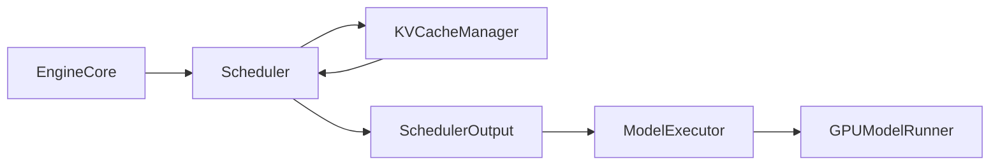

# 设计文档：Scheduler 请求调度

## 摘要

Scheduler 按请求的未计算 token 数分配每步预算。每步先处理 running，再用剩余预算按 FIFO 准入 waiting。调度结果携带每个请求的 token 数和 KV block IDs，Runner 据此计算写入位置。

## 背景与目标

长输入可以拆成多个 chunk，与其它请求的新生成 token 进入同一个 batch。前缀命中可以推进请求的计算起点，KV 容量不足时可以抢占 running 队尾的请求，恢复时用同样的前缀匹配和预算计算流程。

## 调度结果

`SchedulerRequest.from_engine_core_request()` 将请求 ID、本步 token IDs、起始位置、有序 `block_ids` 和可选采样参数填入调度请求。`SchedulerOutput.running_requests` 包含本步实际执行的请求，`num_scheduled_tokens` 以请求 ID 为键记录每个 chunk 的 token 数。两个类型定义在 `x_tokens/core/protocol.py`。

## 核心流程

1. 初始化本步 token 预算和调度结果。按 running 队列顺序为每个请求取 `num_uncomputed_tokens`，计算本步可执行的 token 数。
2. 请求 KV cache 为本步结束位置分配 block。容量不足时，释放 running 队尾请求持有的 block，将被抢占的请求放回 waiting，清空其计算进度和前缀 hash，再重试当前请求。被抢占请求已生成的 token 保留。
3. 本步未发生抢占时，在预算和 `max_num_seqs` 允许的范围内处理 waiting。先查 APC 命中的完整 block，再为未计算部分分配预算。只有 KV 分配成功才移动请求到 running。
4. Scheduler 从 `num_computed_tokens` 起截取本步 token。Executor 从 `SchedulerRequest` 读取本步 token 和 block IDs 并发给 Runner。Runner 用 token 的逻辑位置索引 block IDs，再以 `block_id * block_size + offset` 得到 slot。
5. forward 成功后，Scheduler 按请求 ID 从 running 队列取出原请求。通过 `KVCacheManager.cache_blocks()` 登记新完成的 APC block，再写回请求进度。只有本步覆盖该请求全部待计算 token 时才采样。

## 兼容性与配置

沿用 `max_prefill_batch_tokens` 和对应的 CLI 参数。启用 chunked prefill 时，该参数限制本步所有请求的 token 总数，单独运行的长输入也按这个上限分块。关闭时，请求的待计算 token 作为整体调度。超过预算的单个请求可以独占一步。

## 验证

`tests/engine/test_scheduler.py` 覆盖 running 优先、混合长度、分块预算和按 chunk 提交。`tests/engine/test_kv_cache_manager.py` 覆盖分配失败、抢占重试和前缀复用。`tests/modeling/test_qwen3_5.py` 对照 Transformers 验证混合长度和跨 block 继续执行时的模型输出。
