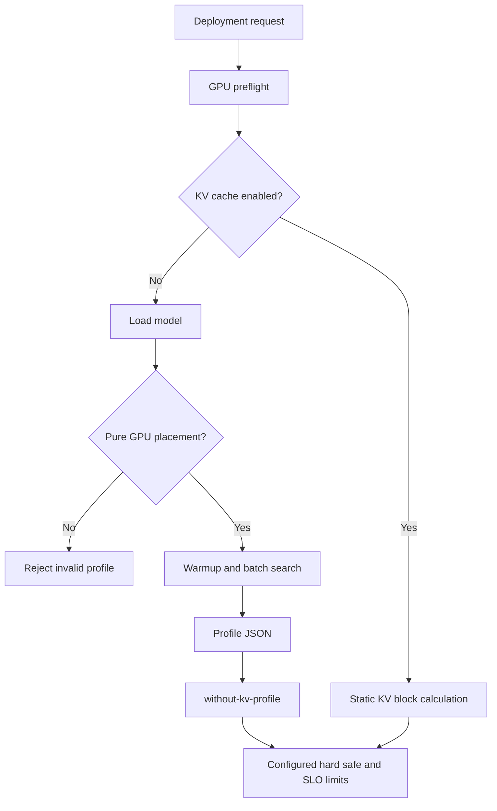
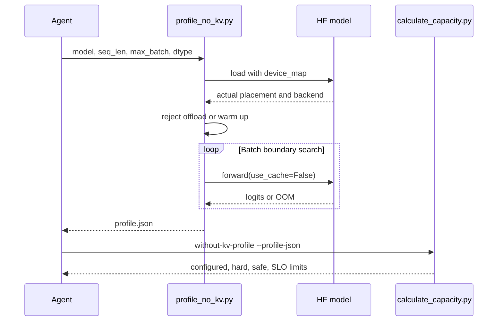
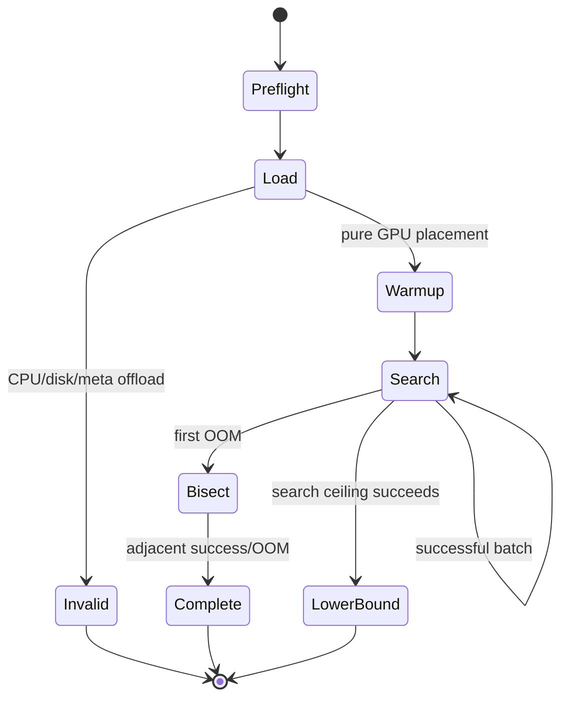

# Design Document

## Summary

本设计将仓库内 `calculate-inference-hbm` Skill 从静态公式计算扩展为“静态估算 + 实测校准”
工作流。新增 `profile_no_kv.py` 对无 KV cache 部署执行 GPU 环境快照、placement/offload 校验、
warmup、batch 边界搜索及性能采样；`calculate_capacity.py` 新增 `without-kv-profile` 模式，使用
profiler 报告中的逐卡真实 free HBM 和峰值斜率输出配置上限、实测硬上限、安全建议和 SLO
占位。该方案保留现有 KV 公式路径，并避免将 CPU offload、加载前 attention 配置或静态 tensor
生命周期假设误认为有效的两卡 GPU 容量结果。最终实现已通过 36 项仓库测试、Ruff、Skill
validation、双 A6000 smoke test 和独立前向验证。

## Background

现有 Skill 已区分 KV/no-KV 路径，并提供逐卡静态显存公式。一次真实的 Qwen3-30B-A3B
双 A6000 测量暴露了以下问题：

- `device_map="auto"` 会根据模型加载瞬间的 free HBM 改变 placement；GPU 瞬时被占用时，
  Accelerate 会把层和 `lm_head` offload 到 CPU，导致所谓“两卡测试”失效。
- 磁盘 config 在模型加载前没有给出最终 attention backend；本次加载后才确认实际使用 SDPA。
- no-KV 静态公式把多个 tensor 相加，但它们未必同时存活；猜测 activation multiplier 无法替代
  峰值测量。
- `memory_allocated` 不包含全部 driver/context 占用。安全余量应从 warmup 后真实 free HBM
  扣除，而不是只从总 HBM 减去估计项。
- HBM 能容纳的 batch 不等于合理服务并发。本次完整上下文重算的 aggregate throughput 基本不随
  batch 增加，而单请求 TPOT 显著恶化。

因此需要把环境有效性校验、实测容量和性能采样变成 no-KV 路径的标准步骤。

## Goals

- 在 no-KV profiler 中记录 visible GPU、加载前/后/warmup 后逐卡显存。
- 加载后检查实际 `hf_device_map`、逐卡参数 bytes、attention backend、dtype 和 logits storage。
- 检测 `cpu`、`disk`、`meta` offload；纯 GPU 容量测试发现 offload 时立即失败。
- 对固定 `L_pad` 自动执行 batch 探测和 OOM 后二分搜索。
- 输出可复用 JSON 报告，包括逐 case 峰值与 forward 时间。
- 从报告中区分 `configured_limit`、`measured_hard_limit`、
  `recommended_safe_limit` 和 `slo_limit`。
- 保留现有 `with-kv` 和 `without-kv` 静态计算兼容性。

## Non-goals

- 不实现通用性能 benchmark client；profiler 只测一次同步 model forward。
- 不自动终止占用 GPU 的其他进程，也不自动选择或抢占 GPU。
- 不保证随机 token 能覆盖所有 MoE 路由分布；生产结论仍需真实 workload 验证。
- 不修改 xTokens executor、scheduler、模型参数或服务启动配置。
- 不把实测 OOM 边界解释为满足 TTFT、TPOT 或 P99 latency 的并发。
- 不为有 KV cache 的引擎实现 runtime profiler；该路径继续使用 block/token 模型与引擎指标。

## Design Overview



Skill 的 no-KV 路径先执行只读 preflight，再运行 profiler。Profiler 负责产生原始事实，calculator
负责从报告计算容量结论，使测量与策略解耦。详细公式继续保存在
`references/hbm-analysis.md`，`SKILL.md` 只规定不可跳过的流程和输出契约。

## Detailed Design

### Core Flow

1. 使用 `nvidia-smi` 记录物理 GPU ID、UUID、进程和 free HBM，显式设置
   `CUDA_VISIBLE_DEVICES`。
2. 启动 profiler，记录 visible-device index、型号、total/free HBM。
3. 以目标 dtype、`device_map` 和 local-files 策略加载模型。
4. 读取加载后的 `model.hf_device_map`、参数实际 device、
   `model.config._attn_implementation` 和 forward signature。
5. placement 包含 CPU/disk/meta 时输出错误并停止，不执行容量搜索。
6. 使用固定 seed 的随机 token warmup；记录 warmup 后 baseline allocated/reserved/free。
7. 对 batch `1, 4, 8, ...` 探测，首次 OOM 后在成功/失败之间二分，直到相邻。
8. 每个成功 case 记录逐卡 peak allocated、相对 baseline delta、forward seconds、logits dtype、
   logits view shape 和底层 storage bytes。
9. 将完整报告写入 JSON，并用 `without-kv-profile` 计算四层并发结论。
10. 使用真实 workload 对推荐范围执行 TTFT/TPOT/P99 benchmark，填写 `slo_limit`。



### Interfaces and Data Structures

Profiler CLI：

```text
profile_no_kv.py
  --model PATH
  --seq-len N
  --max-batch N
  --dtype {auto,bfloat16,float16,float32}
  --device-map auto
  --warmup-seq-len N
  --input-mode {random,repeated}
  --seed N
  --local-files-only
  --output FILE
```

GPU 选择通过调用进程的 `CUDA_VISIBLE_DEVICES` 完成，脚本不隐式选择设备。默认随机 token 提高
MoE 路由覆盖；`repeated` 仅用于可复现对照。默认沿用模型原始 logits 行为，不主动传入
`logits_to_keep`，以复现当前 executor。

Profiler JSON 的核心结构：

```text
schema_version
model, seq_len, dtype, input_mode, seed, cuda_visible_devices
preload_devices[]
placement{hf_device_map, parameter_bytes, offload_targets, attention_backend}
baseline_devices[]
cases[]{batch, status, seconds, logits, devices[]}
search{max_successful_batch, min_oom_batch, exact_hard_limit}
warnings[]
```

Calculator 新接口：

```text
calculate_capacity.py without-kv-profile
  --profile-json FILE
  --margin-gib N
  [--scheduler-max-seqs N]
```

对每张 GPU，取成功 case 中最大的 `peak_delta_bytes / batch` 作为保守线性斜率：

```text
safe_limit_i = floor((post_warmup_free_bytes_i - margin_bytes) / slope_i)
```

`recommended_safe_limit` 取所有 GPU 的最小值，并且不超过已实测成功 batch、scheduler 上限和
实测硬上限。若搜索上限仍成功，则 `measured_hard_limit=null`，同时输出
`measured_lower_bound=max_successful_batch`，禁止声称得到精确硬上限。

四层输出定义：

| 字段 | 含义 |
| --- | --- |
| `configured_limit` | scheduler 的 `max_num_seqs`；未提供则为 null |
| `measured_hard_limit` | 与最小 OOM batch 相邻的最大成功 batch；未探测到 OOM 则为 null |
| `recommended_safe_limit` | 扣除逐卡真实 free HBM 余量且不超过成功范围的建议值 |
| `recommended_safe_limit_sampled` | 建议 batch 是否在成功 case 中被直接采样 |
| `slo_limit` | profiler 不计算，固定为 null，等待服务 benchmark 填写 |

### Class, Sequence, and State Diagrams

脚本使用纯函数处理 placement、batch 搜索和 profile 分析，不引入持久类状态。



### Compatibility and Migration

- `with-kv` 与 `without-kv` CLI 参数和 JSON 字段保持兼容。
- 新增 `without-kv-profile`，不改变现有调用。
- `SKILL.md` 将 no-KV 静态模式降级为搜索范围估算，把 profiler 路径设为本地模型可用时的
  默认流程。
- `agents/openai.yaml` 的名称和默认 prompt 不变。
- 回滚时删除 profiler 和新 subcommand，并恢复原 no-KV 工作流即可。

## Testing and Evaluation

- 单元测试 offload target 检测和 device-map 正常路径。
- 单元测试 batch 搜索序列、相邻 OOM 边界和仅有 lower bound 的场景。
- 使用合成 profile 测试逐卡 slope、安全余量、scheduler 收紧和四层输出。
- 测试 malformed profile、无成功 case、负 free HBM 和不完整设备数据。
- 保留 Qwen3 KV 96 KiB/token、block 对齐和静态 no-KV 测试。
- 运行 Ruff、全量 Pytest、`quick_validate.py` 和 Markdown whitespace 检查。
- 使用独立 agent 仅提供 Skill 路径和合成/本地部署问题做前向验证。

真实 GPU profiler 的验收条件：加载后无 offload，实际 backend 和 placement 被记录；成功/OOM
边界相邻，报告能够由 `without-kv-profile` 消费。GPU 被其他任务占用时允许只运行单元测试和
合成前向验证，不把受污染结果写成基准结论。

最终验证结果：

- `pytest -q`：36 passed。
- `ruff check docs/skill/calculate-inference-hbm/scripts tests/skill`：通过。
- `quick_validate.py docs/skill/calculate-inference-hbm`：`Skill is valid!`。
- 双 A6000 smoke test 正确记录 24 层/卡、无 offload、SDPA、BF16、
  `logits_to_keep=0` 和 lower-bound-only 状态，生成的 JSON 可由新 subcommand 消费。
- 独立 agent 仅使用 Skill 路径和原始 profile，正确得到 configured=13、hard=15、safe=13、
  SLO=null，并识别建议 batch 未被直接采样的限制。

## Trade-offs and Known Issues

### Advantages

- 使用实际 placement 和 post-warmup free HBM，减少静态公式与运行时的偏差。
- profiler 只产生事实，calculator 单独应用 margin/scheduler，便于重新评估策略。
- 自动拒绝 CPU offload，避免把性能和 HBM 均失真的运行当作有效 GPU 结果。
- 输出同时表达容量、配置和 SLO 边界，降低“能装下即能服务”的误解。

### Limitations

- OOM 探测会短暂逼近 GPU 容量，只应在用户授权且空闲的 GPU 上执行。
- 随机 token 只能改善而不能保证覆盖真实 MoE 路由与 padding 分布。
- batch 与峰值可能非线性；最大 `delta/batch` 只是保守局部模型，不能外推到未测试范围。
- 同步 forward seconds 不是完整 HTTP 服务的 TTFT/TPOT/P99。

### Trade-offs

选择显式 profiler 而不是继续增加静态 activation 系数。这样需要加载模型并占用 GPU，但能观察
tensor 生命周期、allocator、placement 和完整 logits 的真实效果。选择 JSON 文件作为脚本边界，
便于 Agent 审计和复算；代价是需要维护 schema。默认随机 token 平衡可复现性与 MoE 路由多样性，
仍要求最终使用真实 workload 验证。

## Conclusion

本设计已把 no-KV 容量评估升级为可重复的测量流程，同时保留 KV cache 的确定性公式路径。
Skill 能识别无效 offload 部署、报告四层并发限制，并把 HBM 边界与服务性能结论明确分开。

## Completion Criteria

- 设计中的 CLI、JSON 字段、流程与最终实现一致。
- profiler 在 offload 时拒绝继续，在纯 GPU placement 时输出完整报告。
- calculator 能消费 profile 并输出四层并发限制。
- Skill/reference 明确加载后 backend、真实 free HBM、MoE 输入和 SLO 要求。
- 单元测试、Ruff、Skill validation 和前向验证通过。
- 已知限制、未完成项和真实 GPU 验证状态已记录。
