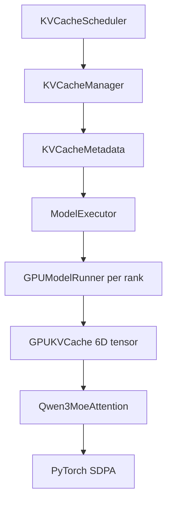
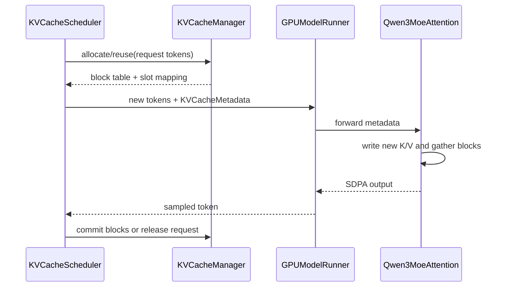
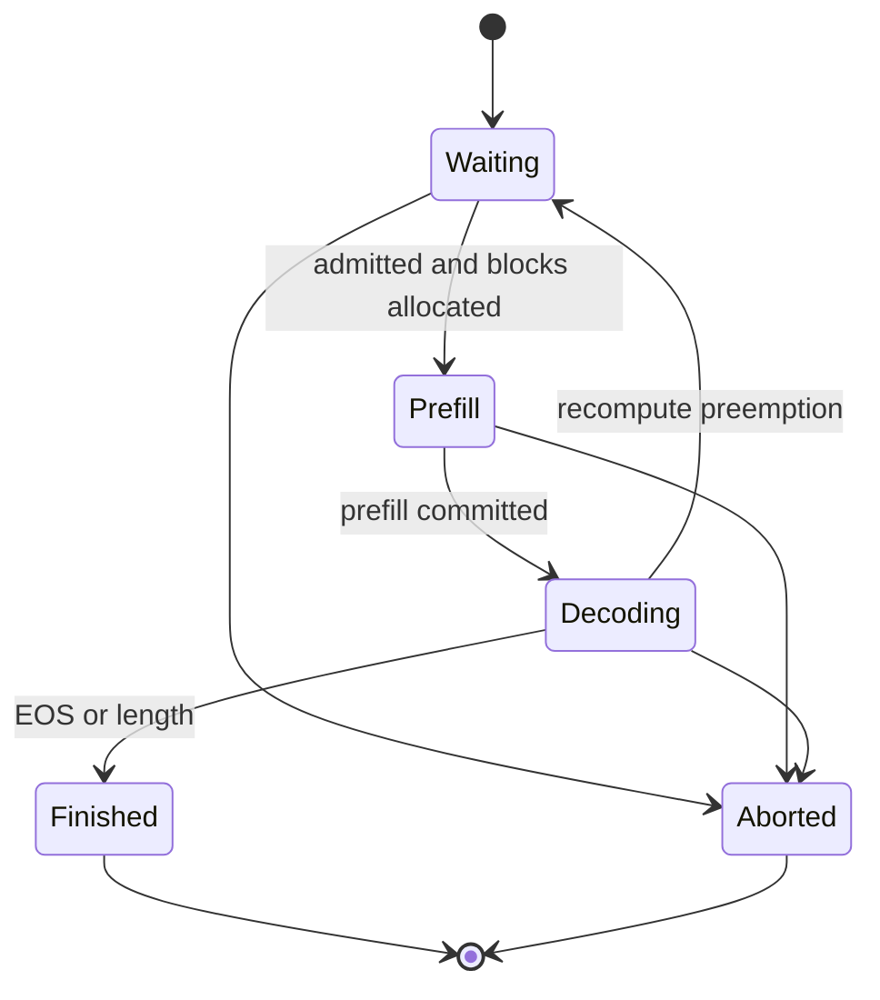

# Design Document

## Summary

实现naive版本的block kv cache管理，支持简单的prefix cache，model forward的时候重新聚合成一个连续的tensor，先暂时不写page attention kernel

> 实现已通过 96 个项目测试，以及真实 Qwen3-30B-A3B、两卡 TP=2 的 HTTP E2E 和 4 并发短基准；custom
链路中不存在 no-cache 配置或 fallback 分支。

## Background

改造前 `GPUModelRunner` 每步接收完整上下文，Qwen3-MoE 会重新计算全部 token 的 Attention 和 MoE。连续
KV tensor 虽然容易实现，但需要按 `max_num_seqs * max_model_len` 预留显存，也无法灵活复用请求间的空闲
空间。初稿要求从第一版开始按 block 管理，并支持 prefix cache。

本设计只覆盖 custom Qwen3-MoE、TP=1/2 和 continuous batching。custom executor、runner 和模型不保留
no-cache 分支；独立的 `naive_hf` 仅作为 Hugging Face 正确性参考后端。KV cache 在每个 TP rank 上只保存
local KV heads，逻辑 block ID 和 block table 由 driver 统一生成并发送到全部 ranks。

## Goals

- decode 每步只计算新增 token，不重新执行历史 token 的模型计算。
- 以固定大小 block 动态管理 KV 显存，支持分配、释放、引用计数和 LRU 驱逐。
- 对完整 token block 计算 hash，支持跨请求 prefix reuse。
- 支持 naive continuous batching，请求结束后立即释放容量并接纳 waiting 请求。
- 第一版复用 PyTorch SDPA，不要求自定义 CUDA/Triton kernel。
- 保持 TP=1/2 数值一致，并正确处理请求完成、abort、preemption 和 `ignore_eos`。
- 保持 block table 和物理布局可被后续 paged attention kernel 直接复用。

## Non-goals

- 第一版不实现 paged attention、FlashAttention 自定义 kernel 或 CUDA Graph。
- 不实现跨进程、跨模型或持久化 prefix cache。
- 不实现 KV cache offload、量化、滑动窗口或 speculative decoding。
- 不支持 PP、EP、CP 与 KV cache 的组合。
- 不保证第一版 KV attention 的吞吐优于成熟的 paged attention 实现。

## Design Overview



职责边界：

| 模块 | 职责 |
|---|---|
| `KVCacheManager` | 逻辑 block、hash、ref count、LRU、block table 和 preemption |
| `KVCacheScheduler` | continuous admission、prefill/decode 交替和 cache plan 提交/回滚 |
| `ModelExecutor` | 将同一份 cache metadata 广播到所有 TP ranks |
| `GPUModelRunner` | 分配物理 cache、准备新增 token 和调用模型 |
| `GPUKVCache` | 按 block ID 读写 rank-local K/V |
| `Qwen3MoeAttention` | 写入新 K/V、gather block、构造 mask 并调用 SDPA |

## Detailed Design

### Core Flow

#### 初始化

1. 模型加载后，各 worker 根据剩余 HBM 和 `gpu_memory_utilization` 计算可用 block 数。
2. `ModelExecutor` 取所有 TP ranks 的最小值，保证各 rank 使用相同 block ID 空间。
3. worker 分配 6D cache；Core 使用相同 `num_blocks` 创建 `KVCacheManager`。

单个 TP rank 的布局为：

```text
[num_layers, 2, num_blocks, block_size, num_local_kv_heads, head_dim]
             ↑
            K/V
```

默认 `block_size=16`，cache dtype 与模型 dtype 相同。Qwen3-30B-A3B 在 TP=2、bf16 下，每个 block 每卡占：

```text
48 layers * 2 * 16 tokens * 2 local KV heads * 128 * 2 bytes = 1.5 MiB
```

#### Naive continuous batching

Scheduler 继续维护 `waiting` 和 `running`，但 admission 同时受 `max_num_seqs` 与可用 KV blocks 限制：

1. 每步开始先释放上一轮完成或 abort 请求的 block 引用。
2. 在 sequence slots 和 blocks 都允许时，从 waiting 按 FIFO 接纳请求。
3. 新接纳请求进入 prefill phase；完成 prefill 后进入 decode phase。
4. decode 每步为所有可运行请求各处理一个新 token。
5. 请求结束释放容量，下一 scheduler step 即可接纳新请求，不等待当前 batch 整体结束。

第一版一次 forward 只执行一种 phase。当 prefill 与 decode 同时存在时，采用简单交替策略：两个 prefill
steps 之间至少执行一个 decode step；没有待 prefill 请求时连续 decode，没有 decode 请求时直接 prefill。
这样支持动态 admission，同时避免持续到达的新请求饿死已有 decode 请求。第一版不做 chunked prefill，
因此长 prompt 的一次 prefill 仍可能增加其他请求的 inter-token latency。

```text
step 1: decode  [A, B]
step 2: prefill [C]
step 3: decode  [A, B, C]
step 4: decode  [A, B, C]
step 5: prefill [D]
step 6: decode  [A, B, C, D]
```

新请求 admission 不得抢占 running 请求；block 不足时继续留在 waiting。只有 running 请求在 decode block
边界无法获得新 block 时，才进入“容量不足”流程中的 recompute preemption。

#### Prefill

1. Scheduler 将 prompt 切成 token blocks，通过 hash 查找最长可复用完整前缀。
2. 命中的 block 增加 ref count；未命中的部分分配新 block。
3. Scheduler 只把未计算 token、block table 和写入位置发送给 runner。
4. 各层 attention 将新 K/V 写入相同 block ID，并读取全部上下文执行 attention。
5. forward 成功后，完整且已计算的 block 才加入 prefix hash table。

为保证能够产生最后一个 prompt token 的 logits，第一版不复用 prompt 的最后一个 block；最多重算
`block_size` 个 token。这样不需要为“KV 已缓存但 hidden state 未缓存”增加特殊路径。

#### Decode

1. Scheduler 发送上一步生成的一个 token，`query_len=1`。
2. Attention 计算该 token 的 Q/K/V，将 K/V 写入当前 block 的下一个 slot。
3. `Qwen3MoeAttention` 按 block table gather 历史 K/V，调用 SDPA 并生成下一 token logits。
4. 请求完成或 abort 时递减其全部 block ref count；完整 hashed block 保留为可驱逐 prefix cache，未完成
   block 立即释放。

每个 scheduler step 只包含 prefill 或 decode，第一版不做 mixed prefill/decode batching。

#### 容量不足

分配顺序为：free block → 驱逐 `ref_count=0` 的最老 hashed block → recompute preemption。preemption 将一个
running request 放回 waiting，释放其引用；恢复时重新查 prefix cache，未命中的部分重新 prefill。任何时刻
都不能驱逐 `ref_count>0` 的 block。

### Interfaces and Data Structures

```python
@dataclass(frozen=True, slots=True)
class KVCacheConfig:
    block_size: int = 16
    gpu_memory_utilization: float = 0.9
    num_gpu_blocks: int | None = None  # 测试和显式覆盖
    enable_prefix_caching: bool = True

@dataclass(slots=True)
class KVCacheBlock:
    block_id: int
    block_hash: bytes | None
    ref_count: int
    computed: bool
    last_access: int

@dataclass(frozen=True, slots=True)
class KVCacheMetadata:
    request_id: str
    is_prefill: bool
    context_len: int
    query_len: int
    block_table: tuple[int, ...]
    slot_mapping: tuple[int, ...]
```

`SchedulerOutput` 增加 `phase`，其值只能为 `prefill` 或 `decode`；同一 output 中所有请求必须处于相同 phase。
`ModelRunnerInput.token_ids` 改为只包含本步新增 token，并增加逐请求 `KVCacheMetadata`。`slot_mapping` 将每个
新增 token 映射为 `block_id * block_size + offset`。Scheduler 是逻辑状态的唯一 owner；worker 不自行分配
block，也不维护 prefix hash。

block hash 只作用于完整且 computed 的 block：

```text
block_hash = digest(model_fingerprint, parent_hash, block_token_ids)
```

hash 必须包含模型和 cache dtype 等兼容性信息；命中后仍校验 token IDs，避免碰撞导致错误复用。共享 block
不可修改，后续 token 总是写入新的或请求私有的尾 block，因此不需要 copy-on-write。

`GPUKVCache` 提供三个最小操作：

```python
class GPUKVCache:
    def write(layer, slot_mapping, key, value) -> None: ...
    def gather(layer, block_tables, context_lens) -> tuple[Tensor, Tensor]: ...
    def clear() -> None: ...
```

第一版 `gather()` 将离散 blocks 复制为 padded dense K/V，并构造 padding/causal mask 后调用 SDPA。后续
`PagedAttention` 直接消费相同的 block table 和 context lengths，届时只替换 attention backend，不改变
Scheduler、`KVCacheManager` 或 cache 生命周期。

### Class, Sequence, and State Diagrams





### Compatibility and Migration

- custom Qwen3-MoE backend 只接受带 `KVCacheMetadata` 的 batch；不存在关闭 KV cache 的配置或执行分支。
- 公开 HTTP API 不变；`naive_hf` 是独立参考后端，不复用 custom executor、runner 或 model code。
- `ignore_eos` 只改变终止条件，不改变 cache 提交和释放规则。
- cache 是运行时状态，不涉及 checkpoint 或持久化数据迁移。
- 回滚方式是切回引入本功能前的版本或使用 `naive_hf` 排查数值问题，不在 custom 路径内运行双实现。

## Testing and Evaluation

- `KVCacheManager`：分配、ref count、最长 prefix、hash 碰撞校验、LRU 驱逐和 preemption。
- `GPUKVCache`：slot 写入、跨 block gather、边界和非法 block ID。
- 数值测试：KV TP=1/2 的 prefill logits 和多步 greedy tokens 与 Hugging Face full-context oracle 一致。
- 生命周期测试：完成、EOS、`ignore_eos`、abort、worker failure 后无 block 泄漏。
- Prefix 测试：相同 prompt 命中，部分前缀命中，共享 block 不被提前驱逐。
- Continuous batching：运行中动态加入请求、不同长度退出、prefill/decode 公平性和 block capacity admission。
- E2E：真实 Qwen3-30B-A3B 两卡完成 prefill、多步 decode 和 continuous batching。
- Benchmark：记录 TPOT、吞吐、逐卡 HBM 和 cache 分配量；性能回归时可用历史版本结果作参考，不在当前
  branch 保留双执行路径。

### Results

- 单元与集成测试：96 passed，覆盖 block 分配、prefix reuse、重复完整尾 block、LRU、物理写入/gather、
  continuous batching、custom executor 强制 KV metadata、TP1/TP2 和多步 decode 数值一致性。
- 真实模型：Qwen3-30B-A3B 在两张 RTX A6000 上以 TP=2 启动成功；每卡加载约 28.44 GiB local weights，
  以 `gpu_memory_utilization=0.75` 分配 9,011 个 block，共 6.60 GiB rank-local KV storage。
- HTTP E2E：单请求与 3 并发请求均返回 200；`ignore_eos=true` 时均生成指定的 4 tokens，France/Germany
  prompt 分别生成 `Paris`/`Berlin`。
- 短基准：32 input tokens、4 output tokens、4 requests、并发 4，结果为 4/4 成功、1.15 req/s、
  4.61 output tok/s、mean TTFT 2100.22 ms、mean TPOT 369.56 ms。该结果只验证链路和提供本版本基线，
  不代表稳定性能结论。

## Trade-offs and Known Issues

### Advantages

- 第一版即建立 block allocator 和 prefix cache，避免以后从 contiguous slot 迁移控制面。
- 无需先实现自定义 kernel，能够较快验证 cache 生命周期与数值正确性。
- TP ranks 共享逻辑 block ID，但只保存 local KV heads，职责清晰。

### Limitations

- gather 每步复制全部历史 K/V，复杂度为 O(context length)。
- dense SDPA 仍有 padding 浪费，长短请求混合时吞吐较低。
- preemption 需要重新 prefill，容量紧张时会抖动。
- 第一版不混合 prefill/decode，GPU 利用率不是最终水平。
- 未实现 chunked prefill，长 prompt 会暂停 decode 一个 scheduler step。
- 尚未提供 prefix hit rate 和每步 gather bytes 的长期运行指标；当前 cache usage 只在 DEBUG scheduler log 中输出。

### Trade-offs

不采用按 `max_model_len` 的连续 per-request cache，因为它实现更简单但无法满足 block 复用和 prefix cache
要求；也不在第一版直接实现 paged attention kernel，因为 cache 生命周期、hash 和调度尚未经过正确性验证。
选择“block 管理 + gather + SDPA”可以稳定控制面接口，后续性能优化只替换数据面。

## Conclusion

第一版已实现 `KVCacheScheduler + KVCacheManager + GPUKVCache + Qwen3MoeAttention`。Scheduler 提供不混合
prefill/decode 的 naive continuous batching，Core 管理逻辑 block 和 prefix，worker 管理 rank-local 6D
tensor，attention gather 后调用 SDPA。该版本目标是正确性、显存按 block 复用和接口稳定；完成基线后再
实现 mixed/chunked scheduling 与直接读取 block table 的 paged attention kernel。

## Completion Criteria

- block 分配、引用计数、prefix reuse、LRU 驱逐和 preemption 测试通过。
- TP=1/2 下多步 KV 输出与 Hugging Face oracle 一致。
- 请求完成、abort 和异常路径没有 block 泄漏。
- 新请求能在其他请求运行期间进入 batch，prefill 和 decode 均不会饥饿。
- 真实模型完成多请求 E2E，日志能观察 cache usage 和 prefix hit rate。
- KV 路径的 HBM、TPOT 和吞吐基线已记录。
- 设计文档中的类名、字段和流程与最终实现一致。
