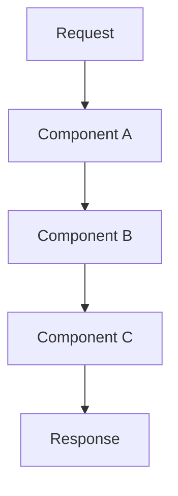
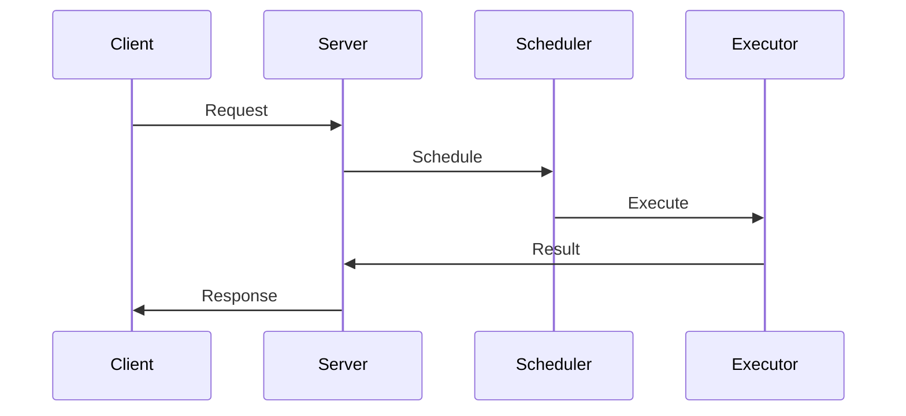
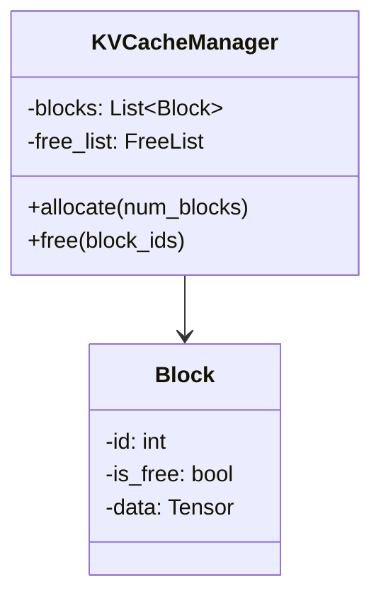

# 设计文档模板

遵循以下结构编写设计文档。设计文档应与代码一同评审和维护，内容应准确反映最终实现。

## TLDR

用一段话概括问题、核心方案、主要收益和验证结果。应足够独立，使读者不阅读全文也能理解本设计的结论。

**示例：** 通过引入块级 KV Cache 管理器，支持动态的缓存块分配和回收，在不增加显存占用的前提下提升序列长度灵活性，并通过集成测试验证了 memory fragmentation 降低 40%。

## 背景

描述当前系统状态和需求。

### 前置条件

基于什么样的条件下开展本次设计。

- 当前系统状态
- 适用范围和约束条件

### 现有问题与需求

说明现有问题、痛点或需求来源。

- **问题 1**：XXX
- **问题 2**：XXX

### 目标

明确本次要实现的功能与可验证目标。

- **功能目标**：支持什么功能、解决什么问题
- **性能目标**：如有性能改动，明确 Benchmark 目标（吞吐、延迟、显存等）
- **可维护性目标**：代码复杂度、模块化程度等（如适用）

## 设计概述

宏观上描述当前怎么做的，说明整体思路和主要特性。

### 核心特性

列举设计中有亮点的、比较核心的地方。

- 特性 1：简要说明这个特性解决什么问题、怎么做
- 特性 2：...

### 架构设计

描述系统整体是什么样的、每个部分干什么。可用 Mermaid 图示。



### 组件职责

基于上面的架构，描述每个组件的职责。

| 组件 | 职责 | 关键接口 |
|------|------|---------|
| Component A | 负责 X | method_1, method_2 |
| Component B | 负责 Y | method_3, method_4 |
| Component C | 负责 Z | method_5, method_6 |

## 详细设计

对于核心实现进行深入描述。

### 关键流程

描述主要执行流程、关键状态和异常处理。必要时提供时序图。

**流程描述：** 简要说明核心流程的步骤。



### 接口与数据结构

描述关键接口、类、数据结构及其约束。可包含 API 签名、字段说明等。

**示例：**

```python
class KVCacheManager:
    """KV Cache 块级管理器"""
    
    def allocate(self, num_blocks: int) -> List[int]:
        """分配指定数量的缓存块"""
        pass
    
    def free(self, block_ids: List[int]) -> None:
        """释放指定块"""
        pass
```

### 关键算法 / 实现

对重要的功能进行简要描述，说明如何实现。

**示例：** 块分配采用最优适配算法，优先分配相邻空闲块以降低 fragmentation。

### 类图（如需要）

Dive into 低层对象关系。



### 目录架构

说明实现对应到代码中的位置。

```
x_tokens/
├── core/
│   ├── engine_core.py       # 主调度逻辑
│   ├── kv_cache.py          # KV Cache 管理（详见下面）
│   └── scheduler.py         # 调度器
├── executor/
│   ├── protocol.py          # 执行器接口
│   └── model_executor.py    # 模型执行器
└── ...
```

**关键模块深入链接：**

- [KV Cache 详细设计](./s1-kv-cache-detail.md)
- [Scheduler 详细设计](./s2-scheduler-detail.md)

### 异常与边界

关键异常处理、已知限制或暂不支持的场景。

- **异常情况 1**：如何处理
- **已知限制**：当前实现的限制是什么

## 测试与评估

说明功能正确性、性能、兼容性等验证情况。

### 功能测试

- 单元测试：覆盖关键模块（`tests/engine/test_kv_cache.py` 等）
- 集成测试：E2E 请求处理链路
- 边界场景：长序列、低显存、异常退出等

### 性能评估

如有性能相关改动，提供 Benchmark 结果。

**示例：**

| 场景 | Baseline | Current | 改进 |
|------|----------|---------|------|
| 吞吐 (req/s) | 100 | 140 | +40% |
| P99 延迟 (ms) | 50 | 42 | -16% |
| 显存占用 (GB) | 20 | 18 | -10% |

### 验证状态

- 功能完成度：✓ 核心流程，✓ 异常处理，○ 性能优化
- 测试通过率：XX/YY 用例通过
- 仍待验证：XXX（可选）

## 总结

总结本次设计的核心方案、主要收益和当前状态。

- **最终方案**：选择了什么方案、主要考虑是什么
- **主要收益**：功能、性能或可维护性的改进
- **当前状态**：实现完成情况、已通过验证、仍存在的限制或后续改进方向

---

## 完成标准 Checklist

在提交设计文档时，确保满足以下条件：

- [ ] 摘要能够独立理解设计的核心价值
- [ ] 背景与目标中的约束条件明确
- [ ] 设计概述中的架构图能清晰表达数据流和模块关系
- [ ] 详细设计中的关键接口、类名、模块名与代码一致
- [ ] 所有 Mermaid 图表能正确渲染
- [ ] 如有性能相关改动，提供了 Benchmark 结果
- [ ] 测试部分明确了各项验证的通过状态
- [ ] 已知限制或异常情况已明确记录
- [ ] 文档中的文件路径和代码引用仍然有效
